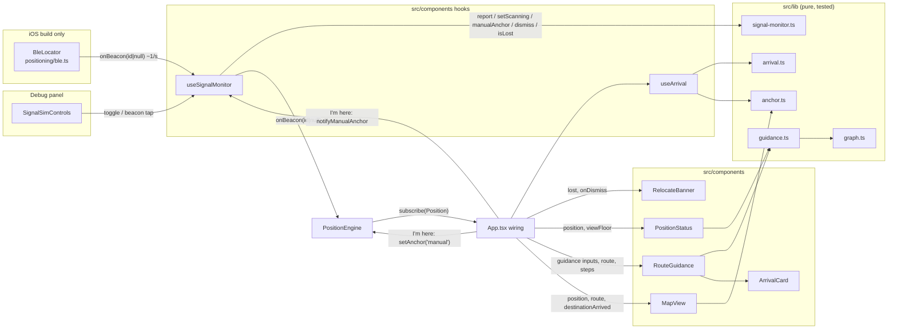
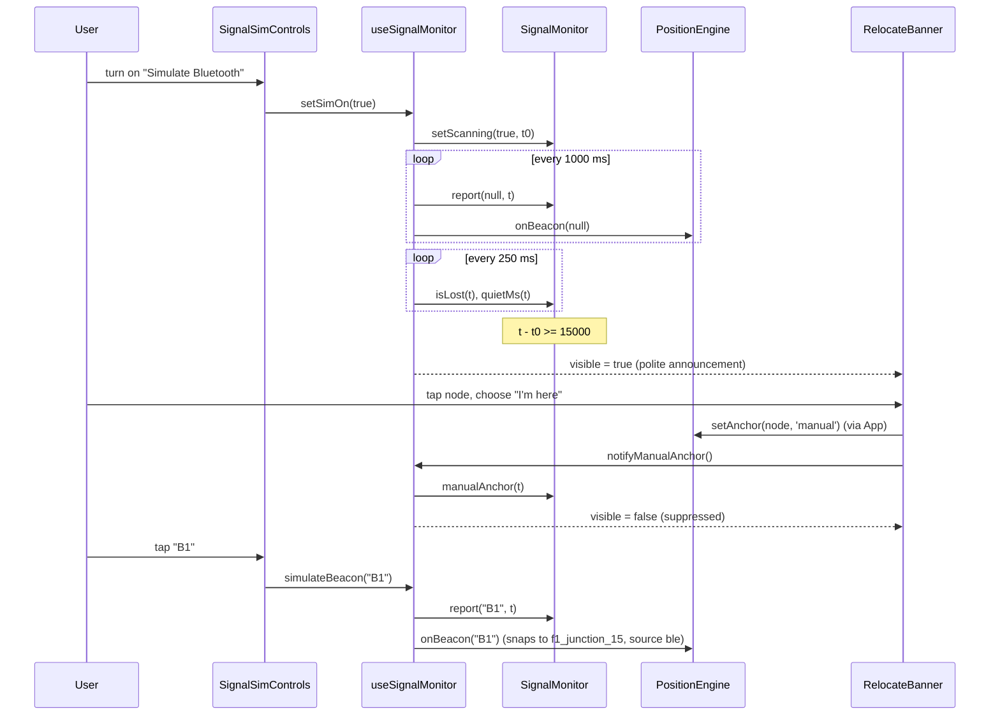
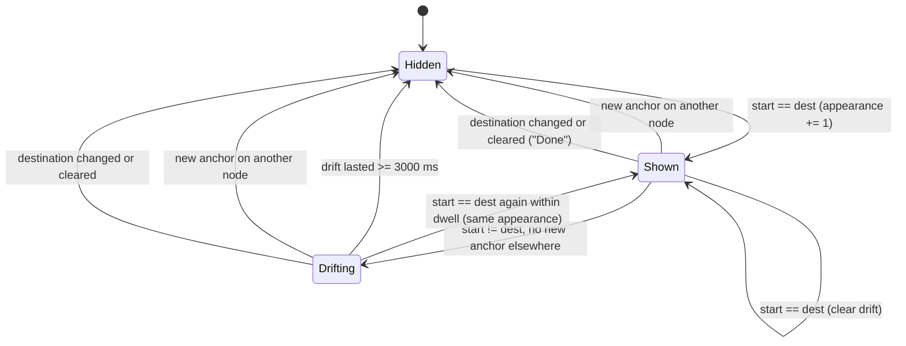

# Design Document: demo-ux-polish

## Overview

This design implements HACKATHON_PLAN Task 3: a clear "you are here" state, a prominent arrival state, and a "Bluetooth signal lost" relocate prompt, plus a Debug-panel Bluetooth simulation so the whole flow can be verified in iPhone Safari on `npm run dev` without the Xcode build.

The design splits into three layers:

1. **Pure logic in `src/lib/`** (new files, tested under plain Node by `npm run test:logic`):
   - `signal-monitor.ts`: turns Bluetooth on/off changes, Beacon_Reports, Manual_Anchors, and dismissals into a signal-lost flag (Requirement 1).
   - `arrival.ts`: the arrival dwell state machine (3 s drift dwell, immediate hide on a new anchor elsewhere or a new destination) (Requirement 6).
   - `guidance.ts`: nearest-landmark lookup, Position_Source labels, the single guidance-hint selector, and destination-picker grouping (Requirements 3.7, 5, 7).
   - `anchor.ts`: detects "a new Anchor was just set" from two consecutive Positions (used by both the pulse animation and the arrival logic).
2. **React glue in `src/components/`** (new hooks and components): `useSignalMonitor.ts`, `useArrival.ts`, `RelocateBanner.tsx`, `PositionStatus.tsx`, `ArrivalCard.tsx`, `RouteGuidance.tsx`, `SignalSimControls.tsx`, `PoliteAnnouncer.tsx`. `MapView.tsx` gets a dedicated top pane for the position marker, the pulse, and an arrival tone for the destination ring.
3. **Small wiring edits** in `src/App.tsx` (imports, two hook calls, rendering the new components, props) and new rules in `src/styles.css`. One constant pair is added to `src/config.ts`.

`PositionEngine` (`src/positioning/engine.ts`) is not modified. All Position changes keep going through `setAnchor`, `onBeacon`, `onStep`, `setPoint`, and `clear`.

### Key design decisions

| Decision | Rationale |
| --- | --- |
| Signal_Monitor is a pure reducer (`applySignalInput`) wrapped by a thin `SignalMonitor` class | The reducer is trivially testable and model-checkable; the class gives the hook an ergonomic, mutable handle. No timers or clocks inside (Req 1.1, 8.2). |
| Queries also advance the "latest accepted timestamp" | Requirement 1.12 treats queries as timestamped inputs. A query earlier than the latest accepted timestamp is answered as of that latest timestamp. |
| Suppression keeps the current Quiet_Period start | The Debug panel keeps showing how long the beacons have been quiet even while the banner is suppressed. Suppression alone gates the flag (Req 1.9, 1.10). |
| Timestamps in the hooks come from `Math.floor(performance.now())` | Monotonic, integer milliseconds. `Date.now()` can jump backward if the phone clock is adjusted; the monitor would then ignore inputs (Req 1.12) and stall. |
| Arrival dwell is a pure helper (`stepArrival`) with an explicit deadline (`arrivalDeadline`) | The 3 s drift rule, the "re-arrive within 3 s is a no-op" rule, and the immediate-hide rules interact; a pure state machine makes them testable without fake timers. The hook schedules one `setTimeout` to the deadline. |
| The position marker moves to a custom Leaflet pane above `overlayPane` | Today every layer is an SVG path in `overlayPane`; when the floor or route layers redraw they are appended after the user marker and paint over it. A dedicated pane fixes Req 5.7 regardless of redraw order ([Leaflet map panes](https://leafletjs.com/examples/map-panes/)). |
| The marker becomes a single persistent `L.marker` with an HTML `divIcon` | CSS keyframe animations on HTML elements are reliable in iOS Safari; restarting the pulse is a class toggle. Moving the marker with `setLatLng` means PDR steps never cut a running pulse short. |
| Live regions are always mounted and their text is set on appearance | Screen readers (VoiceOver especially) often skip live regions that are inserted already containing text. A persistent, initially empty `role="status"` region that receives text when the banner or card appears is announced once per appearance ([MDN: ARIA live regions](https://developer.mozilla.org/en-US/docs/Web/Accessibility/ARIA/ARIA_Live_Regions)). |
| Reduced motion via `@media (prefers-reduced-motion: reduce)` in CSS only | No JS branch needed; the marker still moves, only the animation is dropped ([MDN: prefers-reduced-motion](https://developer.mozilla.org/en-US/docs/Web/CSS/@media/prefers-reduced-motion)). |
| Banner and toast share one flex column (`.map-alerts`) | Stacking them in normal flow guarantees no bounding-box overlap (Req 2.11) without measuring either. |
| Simulated reports go through `engine.onBeacon` and `SignalMonitor.report` via the same function as real BLE | Req 4.10: one code path. The simulation's 1 s `null` tick also resets the engine's `lastBeaconId`, exactly like real scanning. |
| Destination picker sorts with a lower-cased code-unit comparison, ties by node id | Deterministic across Node (tests) and Safari; `localeCompare` results can differ between ICU builds. |

### Research notes

- **Leaflet panes**: `map.createPane(name)` creates a `div` inside the map pane; its `style.zIndex` orders it relative to built-ins (`overlayPane` 400, `markerPane` 600, `tooltipPane` 650, `popupPane` 700). Vector layers given `pane: name` get a pane-specific renderer automatically. The design uses z-index 640: above route lines, node circles, and the destination ring (all in `overlayPane`), below node-name tooltips so labels stay readable.
- **Non-interactive markers**: Leaflet's CSS sets `pointer-events: none` on `.leaflet-marker-icon` unless the marker is interactive, so an `interactive: false` marker never steals node taps or map pans (Req 2.4).
- **Live regions**: `role="status"` implies `aria-live="polite"` and `aria-atomic="true"`. Text changes inside a mounted region are announced; re-rendering identical text does not change the DOM and is not re-announced. Neither action moves focus (Req 2.10, 5.8, 6.5).
- **CSS vs SVG presentation attributes**: an author CSS `stroke` rule overrides the `stroke` attribute Leaflet writes on a path, so the destination ring's arrival color can live in `styles.css` next to the Arrival_Card color (Req 6.7).
- **Node test runner**: `node --experimental-transform-types --test tests/*.test.ts` already strips TypeScript, including constructor parameter properties. New `tests/*.test.ts` files are picked up by the existing glob. Helpers outside the glob (for example `tests/prng.ts`) are imported, not run. `fast-check` is not installed, so property tests use a small seeded generator.

## Architecture



### Signal-lost sequence (simulation in Safari)



### Arrival state machine



"Drifting" is `shown: true` with `driftSince !== null`. A destination change evaluates the new destination immediately, so selecting the node the route already starts at goes straight to a new Shown appearance (Req 6.1).

### Files touched

| File | Change |
| --- | --- |
| `src/config.ts` | Add `SIGNAL_QUIET_THRESHOLD_MS = 15_000` and `ARRIVAL_DWELL_MS = 3_000`. |
| `src/lib/signal-monitor.ts` | New. Pure reducer + `SignalMonitor` class. |
| `src/lib/arrival.ts` | New. `stepArrival`, `arrivalDeadline`. |
| `src/lib/guidance.ts` | New. `nearestLandmark`, `sourceLabel`, `positionStatusText`, `destinationName`, `destinationGroups`, `guidanceFor`. |
| `src/lib/anchor.ts` | New. `newAnchorNodeId`. |
| `src/components/useSignalMonitor.ts` | New hook: monitor instance, simulation timer, refresh timer, callbacks. |
| `src/components/useArrival.ts` | New hook: runs `stepArrival`, schedules the dwell deadline. |
| `src/components/PoliteAnnouncer.tsx` | New. Always-mounted visually hidden `role="status"` region. |
| `src/components/RelocateBanner.tsx` | New. |
| `src/components/PositionStatus.tsx` | New. |
| `src/components/ArrivalCard.tsx` | New. |
| `src/components/RouteGuidance.tsx` | New. Owns the hint / no-route / route summary / steps / arrival block now inline in `App.tsx`. |
| `src/components/SignalSimControls.tsx` | New. Debug-panel simulation UI. |
| `src/components/MapView.tsx` | Add `you` pane, persistent divIcon marker with pulse, optional `destinationArrived` prop. |
| `src/styles.css` | New rules: `.map-alerts`, `.relocate`, `.pos-status`, `.arrival`, `.you-marker`, `.dest-ring.arrived`, `.sr-only`, keyframes, reduced-motion overrides, `--arrival` color. |
| `src/App.tsx` | Imports, `useSignalMonitor`, `useArrival`, render new components, pass props. |
| `tests/signal-monitor.test.ts`, `tests/arrival.test.ts`, `tests/guidance.test.ts`, `tests/engine-anchor.test.ts` | New tests. |
| `tests/prng.ts` | New seeded generator helper (not matched by the `*.test.ts` glob). |

## Components and Interfaces

### `src/config.ts` (additions)

```ts
/** Beacons silent this long while scanning => "Bluetooth signal lost". */
export const SIGNAL_QUIET_THRESHOLD_MS = 15_000;
/** Arrival card stays up through position drift shorter than this. */
export const ARRIVAL_DWELL_MS = 3_000;
```

These are the only places the values appear. The monitor, hook, simulation, and Debug panel import them (Req 8.6).

### `src/lib/signal-monitor.ts`

Imports: `../config.ts` only (Req 8.2).

```ts
export type SignalInput =
  | { kind: 'scanning'; on: boolean; t: number }
  | { kind: 'beacon'; id: string | null; t: number }
  | { kind: 'manualAnchor'; t: number }
  | { kind: 'dismiss'; t: number };

export interface SignalState {
  scanning: boolean;
  /** start of the current Quiet_Period, or null when none is in progress */
  quietStart: number | null;
  /** set by a Manual_Anchor or dismissal; cleared by a non-null report or scanning off */
  suppressed: boolean;
  /** latest accepted timestamp (inputs and queries); -Infinity initially */
  lastT: number;
}

export const INITIAL_SIGNAL_STATE: SignalState;

/** Pure transition. Returns the same object when the input is ignored. */
export function applySignalInput(s: SignalState, input: SignalInput): SignalState;

/** Pure query. `state` is s with lastT advanced (unchanged when t < s.lastT). */
export function querySignal(
  s: SignalState, t: number, thresholdMs: number,
): { state: SignalState; lost: boolean; quietMs: number };

export class SignalMonitor {
  constructor(thresholdMs?: number); // default SIGNAL_QUIET_THRESHOLD_MS; RangeError if not finite and > 0
  get state(): SignalState;
  setScanning(on: boolean, t: number): void;
  report(beaconId: string | null, t: number): void;
  manualAnchor(t: number): void;
  dismiss(t: number): void;
  isLost(t: number): boolean;
  quietMs(t: number): number;
}
```

Transition rules (`applySignalInput`), applied only if `Number.isInteger(t)` and `t >= s.lastT`; otherwise `s` is returned unchanged (Req 1.12). Every accepted input sets `lastT = t`.

| Input | Scanning off | Scanning on |
| --- | --- | --- |
| `scanning on` | `scanning = true`, `quietStart = t`, `suppressed = false` (1.5) | unchanged except `lastT` (1.5) |
| `scanning off` | unchanged except `lastT` | `scanning = false`, `quietStart = null`, `suppressed = false` (1.11) |
| `beacon id` (non-null) | ignored, state unchanged (1.4) | `quietStart = null`, `suppressed = false` (1.6) |
| `beacon null` | ignored (1.4) | `quietStart ??= t` (1.7) |
| `manualAnchor` | ignored (1.4) | `suppressed = true` (1.9) |
| `dismiss` | ignored (1.4) | `suppressed = true` (1.10) |

"Ignored" while scanning is off means the full state, including `lastT`, is unchanged, matching 1.4 literally.

Query (`querySignal`): let `t' = max(t, s.lastT)` (an earlier query is answered as of the latest accepted timestamp, Req 1.12). Accepted queries advance `lastT` to `t`.

```
lost    = scanning && !suppressed && quietStart !== null && t' - quietStart >= thresholdMs
quietMs = scanning && quietStart !== null ? t' - quietStart : 0
```

Because the query depends only on state and `t'`, repeating it at the same timestamp returns the same answer (Req 1.14). A non-null report sets `quietStart = null`, and any later Quiet_Period starts at or after that report, so the flag stays false for at least `thresholdMs` (Req 1.13).

### `src/lib/arrival.ts`

Imports: `../config.ts`.

```ts
export interface ArrivalState {
  shown: boolean;
  destId: string;            // '' when no destination
  driftSince: number | null; // when start first differed from dest while shown
  appearance: number;        // increments on every Hidden -> Shown transition
}

export interface ArrivalInput {
  startId: string | null;      // route start node (App's fromId)
  destId: string;              // '' when none selected
  anchorNodeId: string | null; // node of a just-set manual/ble Anchor, else null
  t: number;
}

export const INITIAL_ARRIVAL_STATE: ArrivalState; // { shown:false, destId:'', driftSince:null, appearance:0 }

export function stepArrival(s: ArrivalState, i: ArrivalInput, dwellMs?: number): ArrivalState;
/** Time at which stepArrival would hide a drifting card, or null. */
export function arrivalDeadline(s: ArrivalState, dwellMs?: number): number | null;
```

`stepArrival` algorithm (`dwellMs` defaults to `ARRIVAL_DWELL_MS`):

```
if i.destId === '':                       return hidden(destId '')               // 6.6
shown = (i.destId === s.destId) ? s.shown : false                                // 6.10 dest change
if i.startId === i.destId:
    appearance = shown ? s.appearance : s.appearance + 1                         // 6.1, 6.3, 6.5
    return { shown: true, destId, driftSince: null, appearance }                 // 6.9
if !shown:                                return hidden
if i.anchorNodeId !== null:               return hidden                          // 6.10 (anchor != dest here)
since = s.driftSince ?? i.t
if i.t - since >= dwellMs:                return hidden                          // 6.8
return { shown: true, destId, driftSince: since, appearance: s.appearance }      // 6.9
```

`hidden` keeps `appearance` so React keys stay unique across appearances.

### `src/lib/anchor.ts`

```ts
/**
 * Node id of a newly set Anchor (source manual or ble) when `next` is a new
 * anchor relative to `prev`; otherwise null. PDR and sim updates never count.
 */
export function newAnchorNodeId(prev: Position | null, next: Position | null): string | null;
```

`next` counts as new when `next.source` is `manual` or `ble`, `next.nodeId` is set, and `prev` is null or differs in `timestamp`, `source`, or `nodeId`. Used by `MapView` (pulse, Req 5.5) and `useArrival` (Req 6.10).

### `src/lib/guidance.ts`

Imports: `./graph.ts` (`nodeLabel`), `./types.ts`.

```ts
export interface Landmark { node: GraphNode; label: string }

/** Nearest named node on `floor` by Euclidean plan distance; ties -> first in building.nodes.
 *  Falls back to the nearest node of any kind (label via nodeLabel). Null if the floor has no nodes. */
export function nearestLandmark(building: Building, floor: string, x: number, y: number): Landmark | null;

export function sourceLabel(source: PositionSource): string;
// ble -> "Bluetooth", manual -> "I'm here", pdr -> "Steps", sim -> "Teleport"

/** { near: "You are near Crossroads Cafe", source: "Bluetooth", key } or null (Req 5.1–5.3, 5.10). */
export function positionStatusText(building: Building, pos: Position | null):
  { near: string; source: string; landmarkId: string } | null;

/** Name shown in the picker and the route header (Req 7.3). n.name if non-empty, else nodeLabel(n). */
export function destinationName(n: GraphNode): string;

export interface DestinationGroup { floor: Floor; nodes: GraphNode[] }
/** Named nodes grouped in building.floors order, sorted case-insensitively by name then id; empty groups omitted. */
export function destinationGroups(building: Building): DestinationGroup[];

export type Guidance =
  | { kind: 'needPosition' }                          // 3.7
  | { kind: 'needPositionForDest'; destName: string } // 7.1
  | { kind: 'needDest' }                              // 7.2
  | { kind: 'noRoute'; destName: string }             // 3.6, 7.6
  | { kind: 'route'; destName: string }               // 7.3
  | { kind: 'arrived'; destName: string };            // 6.1

export function guidanceFor(i: {
  positionKnown: boolean;
  destName: string | null; // null when no destination selected
  hasRoute: boolean;
  arrived: boolean;        // ArrivalState.shown
}): Guidance;
```

`guidanceFor` decision order: no position and no destination → `needPosition`; no position with destination → `needPositionForDest`; position without destination → `needDest`; `arrived` → `arrived`; no route → `noRoute`; else `route`. Returning a single tagged value makes "at most one hint at a time" (Req 7.7) true by construction.

A "named node" is one whose `name` is a string with at least one non-whitespace character. The existing `destinations()` in `graph.ts` (which also excludes junctions and sorts with `localeCompare`) is left unchanged so its test keeps asserting the same thing; the picker switches to `destinationGroups`.

### `src/components/useSignalMonitor.ts`

```ts
export interface SignalMonitorApi {
  lost: boolean;
  quietSeconds: number;              // Math.floor(quietMs / 1000)
  simOn: boolean;
  simDisabled: boolean;              // true while real BLE is on (Req 4.8)
  setSimOn(on: boolean): void;       // no-op while simDisabled
  reportBeacon(id: string | null): void;   // stable identity; real BLE path
  simulateBeacon(id: string): void;        // Debug beacon buttons
  notifyManualAnchor(): void;
  dismiss(): void;
}

export function useSignalMonitor(opts: { engine: PositionEngine; realBleOn: boolean }): SignalMonitorApi;
```

Behavior:

- Holds one `SignalMonitor` in a `useRef`. `now = () => Math.floor(performance.now())`.
- `refresh()` queries `isLost(now())` and `quietMs(now())` and calls `setState` only when either displayed value changes.
- `reportBeacon(id)`: `monitor.report(id, now())`, `engine.onBeacon(id)`, `refresh()`. Same function for real and simulated reports (Req 4.10). Callbacks are created once with `useCallback` and read changing values from refs, so `ble.start({ onBeacon: signal.reportBeacon })` never holds a stale closure.
- Effect on `realBleOn || simOn`: `monitor.setScanning(on, now())`, then `refresh()` (Req 4.2, 4.7, 2.8).
- Effect on `simOn`: while on, `setInterval(() => reportBeacon(null), 1000)`; cleared on turn-off or unmount, so no simulated report is delivered after the turn-off moment (Req 4.3, 4.7). It runs at the App level, so it keeps going with the Debug panel closed.
- Effect on `realBleOn`: if it becomes true while `simOn`, call `setSimOn(false)` (Req 4.9). Scanning stays on because real BLE is on; the monitor treats the repeated turn-on as a no-op (Req 1.5).
- Refresh interval of 250 ms while scanning is on (real or simulated) meets the 1 s display/hide bound (Req 2.1, 2.8) and the 1 s Debug refresh (Req 4.6).
- `simulateBeacon(id)` = `reportBeacon(id)`.
- `notifyManualAnchor()` / `dismiss()`: call the monitor, then `refresh()` synchronously so the banner hides in the same render (Req 2.5, 2.7).

### `src/components/useArrival.ts`

```ts
export function useArrival(opts: { startId: string | null; destId: string; position: Position | null }):
  { shown: boolean; appearance: number };
```

- Keeps `ArrivalState` in state and the previous Position in a ref.
- On every change of `startId`, `destId`, or `position`: `anchorNodeId = newAnchorNodeId(prevPos, position)`, then `stepArrival(state, { startId, destId, anchorNodeId, t: now() })`.
- After each step, if `arrivalDeadline(state)` is non-null, schedule one `setTimeout` for the remaining time that re-runs `stepArrival` with the current inputs and `anchorNodeId: null`. The timeout is cleared on the next step or unmount.

### `src/components/PoliteAnnouncer.tsx`

```tsx
export default function PoliteAnnouncer({ message }: { message: string }): JSX.Element;
// <div className="sr-only" role="status" aria-live="polite" aria-atomic="true">{message}</div>
```

Always rendered by its parent. Parents pass `''` while hidden and the text while visible, so each appearance is one DOM text change and one announcement.

### `src/components/RelocateBanner.tsx`

```tsx
interface Props { visible: boolean; onDismiss: () => void }
```

- Always mounted (inside `.map-alerts`) so its `PoliteAnnouncer` exists before the first appearance.
- When `visible`: renders `<div className="relocate">` with a title "Bluetooth signal lost", the instruction "Tap where you are on the map, then choose “I’m here”.", and `<button aria-label="Dismiss" className="relocate-dismiss">✕</button>` (min 44 × 44 CSS px, Req 2.6).
- Announcer message while visible: "Bluetooth signal lost. Tap where you are on the map, then choose I’m here." No `autoFocus`, no focus calls (Req 2.10).
- Text wraps (`overflow-wrap: anywhere`, no `white-space: nowrap`, no `text-overflow`), so it is fully visible at 320 px (Req 2.3).

### `src/components/PositionStatus.tsx`

```tsx
interface Props {
  building: Building;
  position: Position | null;
  viewFloor: string;
  onShowFloor: (floorId: string) => void;
}
```

- Calls `positionStatusText(building, position)` in a `useMemo` keyed on `position`.
- Renders a persistent `<div className="pos-status" role="status" aria-live="polite" aria-atomic="true">` containing "You are near …" and a source chip. The text depends only on landmark label and source, so PDR steps that keep the same nearest landmark leave the DOM text unchanged and nothing is re-announced (Req 5.8).
- Renders nothing inside the region when the result is null (Req 5.10).
- When `position.floor !== viewFloor`: a button labelled with that floor's `label` (for example "Floor 1") calling `onShowFloor(position.floor)` (Req 5.4). The button sits outside the live region.

### `src/components/ArrivalCard.tsx`

```tsx
interface Props { visible: boolean; destName: string; appearance: number; onDone: () => void }
```

- Always mounted by `RouteGuidance`, with its own `PoliteAnnouncer` (message `You’ve arrived at ${destName}` while visible, `''` otherwise) (Req 6.5).
- When visible, renders `<div className="arrival" key={appearance}>` with "You’ve arrived" (24 px) and the destination name (22 px), and a "Done" button. Keying by `appearance` means the CSS entrance animation (`arrival-in`, 600 ms, `animation-iteration-count: 1`) plays once per appearance and never during re-renders (Req 6.3). Reduced motion removes the animation (Req 6.4).

### `src/components/RouteGuidance.tsx`

```tsx
interface Props {
  positionKnown: boolean;
  destNode: GraphNode | undefined;
  route: Route | null;
  steps: DirectionStep[];
  accessible: boolean;
  arrival: { shown: boolean; appearance: number };
  onDone: () => void;
}
```

Computes `guidanceFor(...)` and renders exactly one of:

| Guidance | Rendered |
| --- | --- |
| `needPosition` | hint: "Turn on Bluetooth, or tap a place on the map and choose “I’m here”." |
| `needPositionForDest` | destination name + hint: "Tap where you are on the map and choose “I’m here”." |
| `needDest` | hint: "Choose a destination above, or tap a room and choose “Navigate here”." |
| `noRoute` | destination name + "No route found" (+ accessible-routing tip when `accessible`) |
| `route` | destination name, distance/time summary, turn-by-turn list |
| `arrived` | (nothing extra; ArrivalCard shows) |

`ArrivalCard` is always rendered with `visible = guidance.kind === 'arrived'`, which puts it in place of the turn-by-turn list (Req 6.1).

### `src/components/SignalSimControls.tsx`

```tsx
interface Props {
  beacons: BeaconDef[];
  simOn: boolean;
  disabled: boolean;
  quietSeconds: number;
  lost: boolean;
  onToggle: (on: boolean) => void;
  onBeacon: (id: string) => void;
}
```

- Checkbox labelled "Simulate Bluetooth", `disabled={disabled}`; `onChange` ignored when disabled (Req 4.1, 4.8).
- While `simOn`: one button per `beacons` entry, labelled with the beacon id (B1, B2, B3), plus "Quiet: {quietSeconds} s · Signal lost: Yes|No" (Req 4.4, 4.6). Threshold text, if shown, is derived from `SIGNAL_QUIET_THRESHOLD_MS`.

### `src/components/MapView.tsx` (changes)

- New optional prop `destinationArrived?: boolean` (optional so existing call sites compile).
- On map creation: `const pane = map.createPane('you'); pane.style.zIndex = '640'; pane.style.pointerEvents = 'none';`
- "You are here" effect: one persistent `L.marker` with `L.divIcon({ className: 'you-marker', html: '<span class="you-halo"></span><span class="you-dot"></span>', iconSize: [36, 36] })`, `{ pane: 'you', interactive: false, keyboard: false }`. Position updates call `setLatLng`; the marker is removed when there is no Position or the Position is on another floor, which leaves the last-known marker in place otherwise (Req 2.12).
- Pulse: keep `prevPos` in a ref. If `newAnchorNodeId(prevPos, position) !== null`, remove the `pulse` class from the icon element, force reflow, add `pulse`, and remove it on `animationend` (Req 5.5). CSS duration 1.2 s.
- Destination ring: `className: destinationArrived ? 'dest-ring arrived' : 'dest-ring'`; `destinationArrived` is added to that effect's dependencies (Req 6.7).

### `src/App.tsx` (wiring only)

```tsx
const signal = useSignalMonitor({ engine, realBleOn: bleOn });
const arrival = useArrival({ startId: fromId, destId: dest, position: pos });
const arrived = arrival.shown;                         // replaces `!!dest && fromId === dest`
const groups = useMemo(() => destinationGroups(building), []);

// toggleBle: ble.start({ onBeacon: signal.reportBeacon, onSnapshot: setBeacons })

// Node_Sheet "I'm here":
onClick={() => {
  engine.setAnchor(sheetNodeObj.id, 'manual');
  signal.notifyManualAnchor();
  setViewFloor(sheetNodeObj.floor);   // Req 3.4 even when the floor did not change from the previous Position
  setSheetNode(null);
}}

// map-wrap:
<div className="map-alerts">
  <RelocateBanner visible={signal.lost} onDismiss={signal.dismiss} />
  {toast && <div className="toast">{toast}</div>}
</div>

// panel:
<PositionStatus building={building} position={pos} viewFloor={viewFloor} onShowFloor={setViewFloor} />
<RouteGuidance positionKnown={!!pos} destNode={destNode} route={route} steps={steps}
               accessible={accessible} arrival={arrival} onDone={() => setDest('')} />

// MapView: destinationArrived={arrived}
// debug: <SignalSimControls beacons={building.beacons} simOn={signal.simOn} disabled={signal.simDisabled}
//          quietSeconds={signal.quietSeconds} lost={signal.lost}
//          onToggle={signal.setSimOn} onBeacon={signal.simulateBeacon} />
```

The picker maps `groups` to `<optgroup>`s with `destinationName(n)` labels. The `destinations` and `nodeLabel` imports are dropped or kept as the remaining code needs (`noUnusedLocals` is on). No new component is defined inside `App.tsx` (Req 8.7).

The Node_Sheet already shows "Navigate here" and "I’m here" unconditionally for every node, and its `z-index: 900` sits above the banner, so Req 3.1 holds without change. Route recomputation after an anchor (Req 3.5, 3.6) already follows from the `fromId` → `route` memo chain.

### `src/styles.css` (additions, summary)

```css
:root { --arrival: #16a34a; }
.map-alerts { position: absolute; top: 10px; left: 12px; right: 60px; z-index: 600;
              display: flex; flex-direction: column; gap: 8px; pointer-events: none; }
.map-alerts > * { pointer-events: auto; }
.map-alerts .toast { position: static; }      /* existing .toast keeps its look */
.relocate { display: flex; gap: 8px; align-items: flex-start; background: #fff7ed;
            border: 1px solid #f97316; border-radius: 12px; padding: 10px 12px; overflow-wrap: anywhere; }
.relocate-dismiss { min-width: 44px; min-height: 44px; }
.arrival { font-size: 22px; ... animation: arrival-in 600ms ease-out 1; }
.arrival h2 { font-size: 24px; color: var(--arrival); }
.dest-ring.arrived { stroke: var(--arrival); }
.you-marker .you-halo, .you-marker .you-dot { ... }
.you-marker.pulse .you-halo { animation: you-pulse 1.2s ease-out 1; }
.sr-only { position: absolute; width: 1px; height: 1px; overflow: hidden; clip: rect(0 0 0 0); white-space: nowrap; }
@media (prefers-reduced-motion: reduce) {
  .you-marker.pulse .you-halo, .arrival { animation: none; }
}
```

`right: 60px` keeps the stack clear of the 40 px floor buttons. At a 320 px viewport the banner is 248 px wide and wraps its text.

## Data Models

### Signal monitor

| Field | Type | Meaning |
| --- | --- | --- |
| `scanning` | `boolean` | Bluetooth scanning (real or simulated) is on. |
| `quietStart` | `number \| null` | Start of the current Quiet_Period in ms, null when none. |
| `suppressed` | `boolean` | Suppression after Manual_Anchor or dismissal. |
| `lastT` | `number` | Latest accepted timestamp; `-Infinity` before any input. |

Inputs are `SignalInput` values with integer-ms `t`. Derived values: `lost` and `quietMs` per the query formula above; the Debug panel shows `Math.floor(quietMs / 1000)`.

### Arrival

| Field | Type | Meaning |
| --- | --- | --- |
| `shown` | `boolean` | Arrival_Card displayed. |
| `destId` | `string` | Destination the state refers to; `''` when none. |
| `driftSince` | `number \| null` | When the route start first differed from the destination during this appearance. |
| `appearance` | `number` | Count of Hidden → Shown transitions; React key for the entrance animation. |

### Guidance and status

- `Landmark`: `{ node: GraphNode; label: string }`.
- `positionStatusText` result: `{ near: string; source: string; landmarkId: string }` or `null`.
- `DestinationGroup`: `{ floor: Floor; nodes: GraphNode[] }`.
- `Guidance`: tagged union with six kinds, listed above.

### Existing types reused unchanged

`Building`, `Floor`, `GraphNode`, `BeaconDef`, `Position`, `PositionSource`, `Route`, `DirectionStep` from `src/lib/types.ts`. No type in `types.ts` changes.

### Constants

| Name | Value | Location |
| --- | --- | --- |
| `SIGNAL_QUIET_THRESHOLD_MS` | `15_000` | `src/config.ts` |
| `ARRIVAL_DWELL_MS` | `3_000` | `src/config.ts` |
| Simulation tick | `1000` ms | `useSignalMonitor.ts` (matches BleLocator's 1 s cadence) |
| Signal refresh tick | `250` ms | `useSignalMonitor.ts` |
| Pulse duration | `1.2 s` | `styles.css` |
| Arrival entrance | `600 ms` | `styles.css` |
| Arrival color | `#16a34a` (`--arrival`) | `styles.css` |
| `you` pane z-index | `640` | `MapView.tsx` |

## Correctness Properties

*A property is a characteristic or behavior that should hold true across all valid executions of a system-essentially, a formal statement about what the system should do. Properties serve as the bridge between human-readable specifications and machine-verifiable correctness guarantees.*

Unless stated otherwise, "sequence" means a list of `SignalInput`s and queries with non-decreasing integer timestamps, a random threshold in `[1, 60_000]` ms, and timestamp gaps biased toward `0`, `threshold - 1`, `threshold`, and `threshold + 1`.

The reference model used by Property 1 is a direct reading of Requirement 1 over the full input history, independent of the reducer:

```
lostRef(history, t, th):
  seg  = inputs after the most recent accepted 'scanning on' received while off
         (none, or a later 'scanning off' => not scanning => false, quiet 0)
  nn   = last non-null beacon in seg
  sup  = any manualAnchor/dismiss in seg after nn (after segment start when no nn)
  qs   = nn ? first null beacon in seg after nn : segment start
  lost = !sup && qs defined && t - qs >= th
  quiet= qs defined ? t - qs : 0
```

### Property 1: Signal monitor matches the history model

*For any* threshold and any sequence of inputs, after every prefix of the sequence, `querySignal` on the reducer's state returns the same `lost` and `quietMs` as `lostRef` on that prefix.

**Validates: Requirements 1.2, 1.5, 1.6, 1.7, 1.8, 1.9, 1.10, 1.11, 2.9, 4.2, 4.6, 4.7**

### Property 2: Scanning off is inert

*For any* reachable state with `scanning === false`, any query returns `lost === false`, and any beacon (null or not), `manualAnchor`, or `dismiss` input returns a state deep-equal to the input state.

**Validates: Requirements 1.3, 1.4**

### Property 3: Stale inputs and queries are ignored

*For any* reachable state with `lastT > -Infinity` and any input or query with `t < lastT`, the input leaves the state deep-equal to before, and the query returns the same `lost` and `quietMs` as a query at `lastT`.

**Validates: Requirements 1.12**

### Property 4: A heard beacon guarantees a full quiet window

*For any* threshold and any sequence containing an accepted non-null beacon report at time `t`, every query in the sequence with timestamp in `[t, t + threshold)` returns `lost === false`.

**Validates: Requirements 1.13**

### Property 5: Queries are idempotent

*For any* reachable state and any timestamp `t`, querying at `t` and then again at `t` with the advanced state returns the same `lost` and `quietMs`, and the second query leaves the state unchanged.

**Validates: Requirements 1.14**

### Property 6: Nearest landmark matches brute force

*For any* generated building (random floors, nodes with and without names, duplicate coordinates to force ties), any floor id, and any point, `nearestLandmark` returns: the first named node on that floor in `building.nodes` order with minimal Euclidean distance when one exists; otherwise the first nearest node of any kind with label `nodeLabel(node)`; otherwise `null` (including floors with no nodes).

**Validates: Requirements 5.1, 5.2, 5.10, 5.11**

### Property 7: Status text depends only on landmark and source

*For any* building and any two Positions on the same floor whose `nearestLandmark` results are the same node and whose sources are equal, `positionStatusText` returns identical `near` and `source` strings; and *for any* Position with a non-null landmark, `near` equals `"You are near " + landmark.label` and `source` equals `sourceLabel(position.source)`.

**Validates: Requirements 5.1, 5.3, 5.8, 5.9**

### Property 8: Only new manual or Bluetooth anchors count as anchors

*For any* pair of Positions `(prev, next)` (either may be null), `newAnchorNodeId(prev, next)` is non-null exactly when `next` has source `manual` or `ble`, has a `nodeId`, and `prev` is null or differs from `next` in `timestamp`, `source`, or `nodeId`; when non-null it equals `next.nodeId`. In particular it is null for every `pdr` and `sim` Position.

**Validates: Requirements 5.5, 6.10**

### Property 9: Arrival is shown at the destination and never without one

*For any* arrival state and any input, `stepArrival` returns `shown === true` when `startId === destId` and `destId !== ''`, and returns `shown === false` when `destId === ''`.

**Validates: Requirements 6.1, 6.6**

### Property 10: One appearance per Hidden-to-Shown transition

*For any* sequence of arrival inputs with non-decreasing timestamps, `appearance` increases by exactly one on each step where `shown` goes from false to true and is unchanged on every other step.

**Validates: Requirements 6.3, 6.5, 6.9**

### Property 11: Drift dwell

*For any* shown arrival state and any sequence of inputs with the same destination and no anchor elsewhere, where the start node differs from the destination over a continuous span: if the start returns to the destination before `dwellMs` has elapsed since the drift began, the card stays shown throughout with the same `appearance`; if an input arrives at or after `driftSince + dwellMs` while still drifting, that input hides the card; and `arrivalDeadline` equals `driftSince + dwellMs` while drifting and `null` otherwise.

**Validates: Requirements 6.8, 6.9**

### Property 12: Anchor elsewhere or new destination hides immediately

*For any* shown arrival state: an input with the same destination, `startId !== destId`, and a non-null `anchorNodeId` hides the card in that step; and an input with a different non-empty `destId` hides the card in that step unless `startId` equals the new destination, in which case the card is shown with `appearance` incremented.

**Validates: Requirements 6.10, 6.1**

### Property 13: Exactly one guidance state, consistent with inputs

*For any* combination of `positionKnown`, `destName` (null or random non-empty string), `hasRoute`, and `arrived`, `guidanceFor` returns exactly one kind, chosen by the decision order (needPosition, needPositionForDest, needDest, arrived, noRoute, route), and every kind other than `needPosition` and `needDest` carries the given `destName` unchanged.

**Validates: Requirements 3.6, 3.7, 7.1, 7.2, 7.3, 7.6, 7.7**

### Property 14: Destination picker grouping

*For any* generated building, `destinationGroups` returns groups whose floors appear in `building.floors` order with no empty group; every node in the output has a name with a non-whitespace character; every such named node appears exactly once in its floor's group; within each group, nodes are sorted by lower-cased name with ties broken by id; and each listed node's picker label equals `destinationName(node)`.

**Validates: Requirements 7.3, 7.4, 7.5**

### Property 15: Anchors through the engine replace any prior Position

*For any* prior Position (built from random `setAnchor`, `setPoint`, and `onBeacon` calls on the real `building.json`) and any node id, `engine.setAnchor(id, 'manual')` yields a Position with that node's floor, x, y, and nodeId and source `manual`; and *for any* beacon in `building.beacons`, `onBeacon(null)` followed by `onBeacon(beacon.id)` yields a Position at the beacon's mapped node with source `ble`.

**Validates: Requirements 3.2, 4.5, 4.10**

## Error Handling

| Situation | Handling |
| --- | --- |
| `SignalMonitor` constructed with a non-finite or non-positive threshold | Throws `RangeError`. Only reachable from code, never from user input. |
| Input or query with non-integer or non-finite `t` | Ignored like a stale input; state unchanged. |
| Input or query with `t` earlier than `lastT` | Ignored; queries answer as of `lastT` (Req 1.12). |
| Beacon report while scanning is off (late BLE callback after stop) | Ignored by the monitor (Req 1.4). The engine still receives it, as today. |
| Real BLE starts while simulation is on | Hook turns simulation off; scanning stays on; only real reports flow (Req 4.9). |
| Simulation toggle activated while real BLE is on | Checkbox is disabled and `setSimOn` is a no-op (Req 4.8). |
| Simulated beacon id not in `building.beacons` | Not possible from the UI (buttons are generated from the list). The engine ignores unknown ids already. |
| Same simulated beacon tapped twice within one 1 s tick with no `null` in between | The engine's existing same-beacon de-dup ignores the second tap. Known, documented limitation; the next `null` tick re-arms it. Engine behavior is not changed because real BLE relies on that de-dup to let PDR move the dot. |
| Position on a floor with no nodes | `nearestLandmark` returns null; Position_Status shows nothing (Req 5.10). |
| Anchored node has no route to the destination | `RouteGuidance` shows the destination name and "No route found"; no route polyline is drawn because `routeNodes` is empty; destination stays selected (Req 3.6, 7.6). |
| Destination restored from `localStorage` or a deep link points at an unnamed node | `destinationName` falls back to `nodeLabel`. |
| `performance.now()` unavailable | Not expected in Safari or WKWebView. No fallback is added. |
| Arrival dwell timer fires after unmount or after inputs changed | The timeout is cleared on every new step and on unmount; a fired timeout re-runs `stepArrival` with current inputs, so a stale timer cannot hide a card that should stay. |
| Toast and banner both visible | Stacked in `.map-alerts` flex column; no overlap (Req 2.11). |

## Testing Strategy

### Approach

Pure logic gets both property tests and a few example tests. UI behavior (layout, animation, announcements, timing within 200 ms or 1 s) is verified manually in iPhone Safari via `npm run dev` with the Debug simulation, plus one native pass on the teammate's Xcode build for real BLE. No UI test framework is added (Req 8.4).

### Property-based testing setup

- `fast-check` is not installed and no dependency may be added, so `tests/prng.ts` provides a small seeded generator: `mulberry32(seed)`, helpers `int(lo, hi)`, `pick(arr)`, `bool()`, `array(gen, lo, hi)`, and `forAll(name, gen, prop, { runs = 100, seed })`. On failure `forAll` throws with the seed, run index, and the JSON of the failing case so it can be replayed. The seed defaults to a fixed value and can be overridden with `PBT_SEED` for exploration.
- Each property in this document is implemented by exactly one `test(...)` that calls `forAll` with at least 100 runs.
- Each property test carries a comment tag in this format:
  `// Feature: demo-ux-polish, Property 1: Signal monitor matches the history model`
- Generators:
  - Signal sequences: 1–60 steps mixing `scanning on/off`, `beacon null`, `beacon B1..B3`, `manualAnchor`, `dismiss`, and queries; gaps from `{0, 1, th-1, th, th+1, random 0..2th}`.
  - Buildings: 1–3 floors, 0–8 nodes per floor (allowing empty floors), names drawn from a small pool including mixed-case duplicates, whitespace-only, and missing; coordinates from a small grid to force ties.
  - Positions: random floor, x, y, optional nodeId, any of the four sources, small timestamp pool to produce equal timestamps.
  - Arrival sequences: node ids from a small pool, destination changes, `''` destinations, anchors, gaps around `dwellMs`.

### Test files

| File | Contents |
| --- | --- |
| `tests/signal-monitor.test.ts` | Properties 1–5. Examples: default threshold is 15,000 ms (lost at `t0 + 15000`, not at `t0 + 14999`) (1.2, 1.8); suppression survives 100 `null` reports after `manualAnchor` and after `dismiss` (1.9, 1.10); repeated turn-on does not reset quiet (1.5); turn-off then on starts fresh (1.11); a source scan of `src/lib/signal-monitor.ts` asserting no `window`, `document`, `navigator`, `setTimeout`, `setInterval`, `Date.now`, and only `../config.ts` imports (1.1, 8.2). Together these cover criteria 1.2 through 1.14 at least once each (1.15). |
| `tests/arrival.test.ts` | Properties 9–12. Examples: arrive, drift 2.9 s, return → same appearance; drift 3.0 s → hidden; "I'm here" elsewhere → hidden in one step; "Done" (`destId ''`) → hidden. |
| `tests/guidance.test.ts` | Properties 6, 7, 8, 13, 14. Examples: `sourceLabel` for all four sources (5.3); `nearestLandmark` on the real `building.json` near `f1_junction_4` returns "Crossroads Cafe"; a floor with no nodes returns null (5.10, 5.11); `destinationGroups` on `building.json` returns one "Floor 1" group in A–Z order. |
| `tests/engine-anchor.test.ts` | Property 15 against the real `building.json`. Example: `onBeacon('B1')` puts the Position at `f1_junction_15` with source `ble`. `localStorage` is absent under Node; the engine already wraps it in `try/catch`. |
| `tests/logic.test.ts` | Unchanged. |

### Commands

- `npm run test:logic` (single run, no watch) must exit 0 with all existing and new tests passing (Req 1.15, 8.5).
- `npm run typecheck` and `npm run build` must exit 0 (Req 8.5).
- `git diff package.json` must show no changes to `dependencies` or `devDependencies` (Req 8.4).
- A search for `15000`, `15_000`, and `15 *` outside `src/config.ts` in `src/` returns no threshold literals (Req 8.6).

### Manual verification (iPhone Safari, `npm run dev`)

1. Load the app: no Position → "tap a place … I’m here" hint (3.7). Pick a destination → destination name + hint (7.1).
2. Debug → "Simulate Bluetooth" on (4.1, 4.2). Quiet counter climbs once per second (4.3, 4.6). At 15 s the banner appears at the top of the map within 1 s, toast and banner don't overlap, map still pans and nodes still open the sheet (2.1–2.4, 2.11). VoiceOver announces it once without moving focus (2.10).
3. Tap a node → "I’m here": banner hides, marker pulses at the node, sheet closes, route updates (2.5, 3.2–3.5, 5.5). Wait past 15 s: banner stays hidden (2.9). Tap "B2": marker snaps to Solution Center with "Bluetooth" source (4.5, 5.3). Wait 15 s: banner returns. Tap "Dismiss": hides, Position unchanged (2.6, 2.7).
4. Switch floors with the fixture-style data or while the Position is shown on another floor: Position_Status shows the floor button and switching works (5.4).
5. Navigate to a nearby room and anchor on it: Arrival_Card with entrance animation, ring turns green (6.1–6.3, 6.7). Teleport away and back within 3 s: card stays (6.9). Stay away for 3 s: steps return (6.8). Anchor elsewhere: hides immediately (6.10). "Done": destination and ring cleared, Position kept (6.6).
6. iOS Settings → Accessibility → Reduce Motion on: marker moves without pulse, card appears without animation (5.6, 6.4).
7. 320 px wide viewport (Safari responsive mode on desktop): banner text fully visible (2.3).

### Native verification (teammate's Xcode build)

Turn real Bluetooth on: simulation toggle becomes disabled; if simulation was on it turns off; walking away from beacons for 15 s shows the banner; returning near a beacon hides it (2.8, 4.8, 4.9). These criteria are INTEGRATION checks and are not automated.

### Why some criteria are not property-tested

Layout, animation, focus, and screen-reader announcements (Req 2.1–2.4, 2.6, 2.10–2.12, 5.4, 5.6, 5.7, 6.2, 6.4, 6.7) are UI rendering concerns; there is no input space for a property to range over and no DOM test runner in the project. They are covered by the manual checklist above, with the logic that drives them (flag, appearance counter, guidance selection) covered by Properties 1–14.
