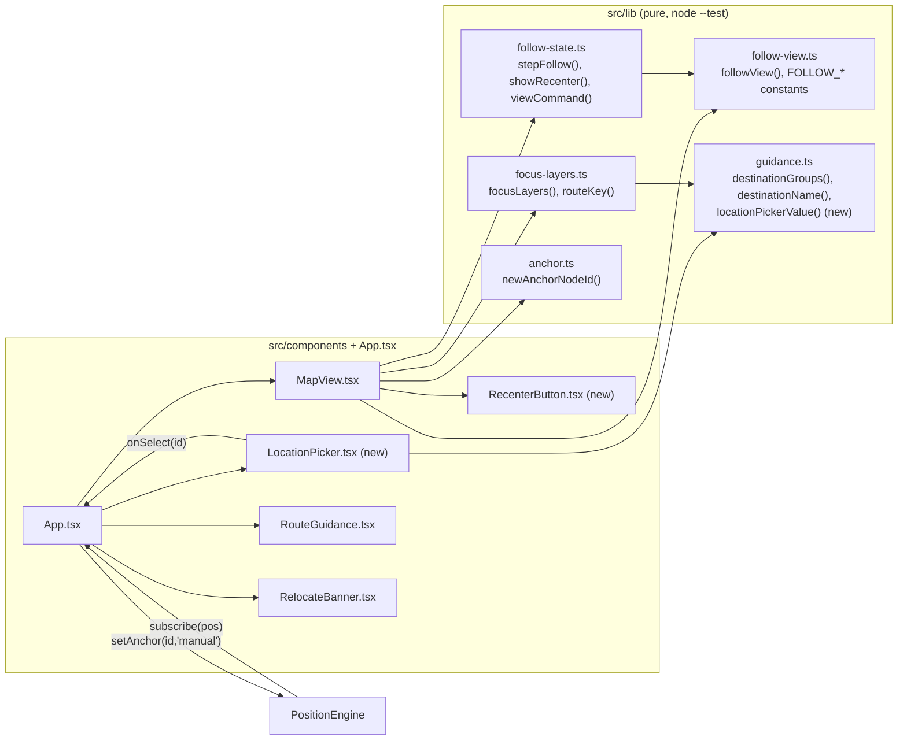
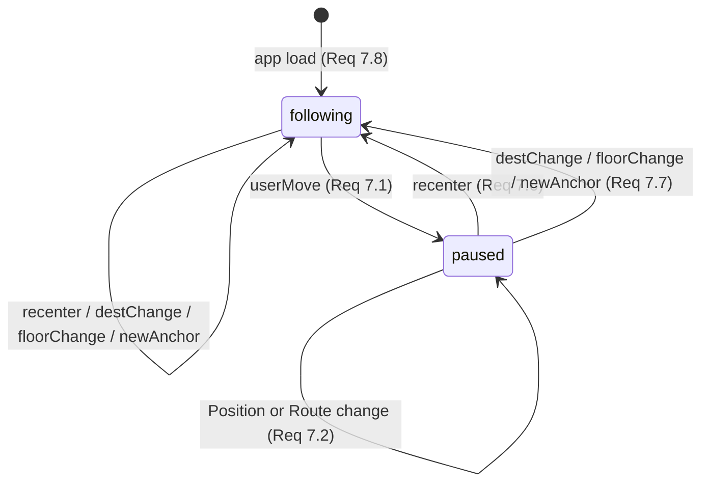
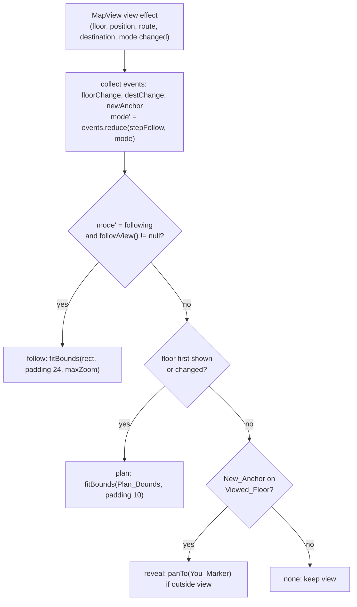

# Design Document: map-focus-view

## Overview

The Map_View today draws a fallback rectangle, the floor image, every corridor edge, every node dot, and a permanent tooltip for every named node (`MapView.tsx`, "draw the floor" effect). This design replaces that with a base layer (Floor_Plan, or Plan_Outline when there is no image or it fails to load) plus three overlays: the Route_Line with a Start_Marker, the Destination_Marker with a permanent label, and the existing You_Marker.

While a Route is active and the Position is on the Viewed_Floor, the map follows the user: on every Position or Route change it fits a Follow_View rectangle centered on the Position that keeps the next few Route nodes in view, at a zoom between 20 m and 40 m across. A User_Map_Move pauses following and shows a Recenter_Button. With no Follow_View, the map fits the whole plan on floor display or change, as before.

"What to draw", "what to show while following", and "which view change to apply" live in three pure modules in `src/lib/`, covered by `npm run test:logic`. The Node_Sheet and `onNodeTap` go away, and a new `LocationPicker` component in the header replaces "tap a node → I'm here". Guidance and banner copy point at "I'm at" and "Where to?".

### Key design decisions

- **Three pure modules, one per concern.** `focus-layers.ts` returns plan-coordinate overlay data. `follow-view.ts` returns the follow rectangle. `follow-state.ts` holds the Follow_Mode reducer and the view-change decision. MapView converts plan points to Leaflet `LatLng`, listens to Leaflet events, and draws. This mirrors how `demo-ux-polish` split `signal-monitor.ts` / `useSignalMonitor.ts`.
- **Follow_View rule.** Clamp the Position to Plan_Bounds. Take the Upcoming_Nodes: the leading run of the Route's first 5 nodes that exist, are on the Viewed_Floor, and lie within 20 m of the clamped Position on each axis. Build a rectangle centered on the clamped Position whose half-width and half-height are the larger of 10 m and the farthest Upcoming_Node on that axis. Then shift the rectangle into Plan_Bounds (or shrink it to the plan size on an axis where the plan is smaller). Result: 20 m to 40 m across, centered on the user except near plan edges, always inside the plan. On the demo plan (`metersPerUnit` 0.12192, 610 × 888 units, about 74 m × 108 m) that is 164 to 328 units, so the view is always closer than the whole-plan fit.
- **Why the Route's first nodes work as "upcoming".** `App.tsx` recomputes the Route from the Route_Start (the Position's node, or the nearest node) on every Position change, so `routeNodes[0]` is always the node nearest the user and the next 4 are the path ahead. No progress tracking is needed.
- **Following replaces the old focus framing.** The earlier `focusBounds` / `frameAction` design (frame the whole Route on Route change) is dropped. It reframed every time the user walked past a node, and framing the whole Route zoomed out instead of in. `focusBounds`' clamped bounding-box idea survives inside `followView`.
- **Follow_Mode is a two-state reducer.** `userMove` → `paused`; `recenter`, `destChange`, `floorChange`, `newAnchor` → `following`. A Route becoming active while paused does not resume on its own; the Recenter_Button is shown instead.
- **One pure view-change decision.** `viewCommand(mode, follow, floorChanged, newAnchor)` returns `follow`, `plan`, `reveal`, or `none` in that priority. It covers Req 6.1, 6.4, 6.5, 6.6, and 7.2 in one property-tested function.
- **User vs programmatic moves.** MapView sets a `programmatic` ref to `true` right before each `fitBounds` / `panTo` it makes and clears it on `moveend`. Leaflet fires `movestart` for every pan or zoom, including drag, pinch, double-tap, scroll wheel, and keyboard pans; `movestart` while `programmatic` is `false` counts as a User_Map_Move. `dragstart` always counts, since Leaflet fires it only for user drags, which also catches a drag that interrupts a running animation.
- **Reduced motion.** Every view change passes `animate: !prefersReducedMotion()`, read from `window.matchMedia('(prefers-reduced-motion: reduce)')` at the time of the call, so a system setting change applies on the next move.
- **Recenter_Button is rendered by MapView.** MapView returns a fragment with the map `<div>` and, when shown, a `RecenterButton` sibling. Both sit inside `.map-wrap`, so `App.tsx` needs no change for it (Req 9.7). The button is a sibling of the Leaflet container, not a child, so taps on it never reach the map, and taps anywhere else do (Req 8.7).
- **Plan-up only.** MapView never rotates the map or the plan. Heading-based rotation is future work.
- **Position does not change the overlay layers.** `focusLayers` accepts the Position (Req 3.1) but its output depends only on the Route, destination, and Viewed_Floor. Req 2.9 holds because `App.tsx` passes an empty Route when `fromId` is null.
- **Single-node runs are dropped.** A Route visit to the Viewed_Floor that is one node long cannot form a line, so it is dropped (Req 3.3, 3.4).
- **Unknown Route ids split the line and end the Upcoming_Nodes.** An id that is not in `building.nodes` ends the current run, the same as a node on another floor. `findRoute` never returns unknown ids, so this only matters for robustness.
- **Dedicated `base` pane.** The image or outline goes into a custom Leaflet pane at z-index 250 with `pointer-events: none`. Vector overlays stay in `overlayPane` (400), the You_Marker in the `you` pane (640), and tooltips in `tooltipPane` (650).
- **No rectangle under the image.** The fallback rectangle is drawn only when there is no image or the image fired `error` (Req 1.2). While the image loads, the `.map` background (`#eef2f7`) shows.
- **Picker value is a pure helper.** `locationPickerValue(groups, position)` in `src/lib/guidance.ts` decides the selected option (Req 4.6, 4.7). `LocationPicker` reuses `destinationGroups`, so both pickers list the same Named_Places in the same order (Req 4.2).
- **Route stays red, solid, with a white casing.** A 10 px white casing under a 6 px `#dc2626` line reads on both the light plan and the dark linework (Req 2.5). The dashed `'2 10'` pattern is dropped because on a busy plan it reads as dots.
- **Settled decisions.** Re-picking the place already selected in "I'm at" does nothing (a `<select>` fires no `change`); Dismiss on the Relocate_Banner still works, and Req 4.6 is unchanged. The Debug label "Tap map to teleport" stays and is excluded from Req 5.9 by wording. `sourceLabel('manual')` stays "I'm here". The Start_Marker stays. `demo-ux-polish` documents are unchanged. No dependencies are added.

### Research notes

- Leaflet `ImageOverlay` fires an `error` event when the image fails (`node_modules/leaflet/src/layer/ImageOverlay.js`, `_overlayOnError`; [Leaflet reference: ImageOverlay](https://leafletjs.com/reference.html#imageoverlay)). MapView listens for `error` to swap in the Plan_Outline (Req 1.4).
- Leaflet picks a renderer per pane, so a `L.rectangle` with `pane: 'base'` gets its own SVG renderer in the `base` pane ([Leaflet reference: Path `pane` option](https://leafletjs.com/reference.html#path-pane)).
- Permanent tooltips open when the owning layer is added to the map, including non-interactive layers, and have `pointer-events: none` unless `interactive: true`, so the destination label does not swallow taps.
- `map.fitBounds(bounds, { padding, maxZoom, animate })` accepts the zoom/pan options of `setView` ([Leaflet reference: fitBounds](https://leafletjs.com/reference.html#map-fitbounds)). Animated pans default to 0.25 s and zoom animations to about 0.25 s (`zoomAnimation`), inside the 300 ms limit of Req 6.2. With `animate: false` the view resets in one step.
- Leaflet's `Map.Drag` handler fires `movestart` then `dragstart`; `TouchZoom`, `ScrollWheelZoom`, `DoubleClickZoom`, and `Keyboard` all go through `_moveStart` or `setView`/`panBy`, which fire `movestart`. Every `setView`, `fitBounds`, and `panTo` ends with `moveend`, including a zero-offset pan (`panBy` fires `moveend` directly when the offset is zero). `invalidateSize` (used by the existing `ResizeObserver`) pans with `_rawPanBy` and fires no `movestart`, so a resize does not pause following.
- With `zoomSnap: 0.25` (already set), small changes in the Follow_View size produce the same snapped zoom, so most walking updates are pans, not zooms.

## Architecture



### Map layer stack (bottom to top)

| Layer (z-index) | Content | Receives pointer input |
| --- | --- | --- |
| `base` pane (250, `pointer-events: none`) | Floor_Plan `L.imageOverlay`, or Plan_Outline `L.rectangle` | No |
| `overlayPane` (400) | Route casing, Route_Line, Start_Marker, Destination_Marker ring (in that insertion order) | No |
| `you` pane (640, `pointer-events: none`) | You_Marker divIcon | No |
| `tooltipPane` (650) | Destination_Marker permanent label | No |
| `.recenter` button (CSS z-index 500 in `.map-wrap`, sibling of `.map`) | Recenter_Button, when shown | Yes, its own box only |

Map clicks still reach `map.on('click')` because every map layer is non-interactive (Req 1.6, 5.3).

### Follow_Mode



### View change on each render (viewCommand)



### Walk a route (sequence)

```mermaid
sequenceDiagram
  actor U as User
  participant LP as LocationPicker
  participant App as App.tsx
  participant E as PositionEngine
  participant MV as MapView
  U->>LP: choose "Arena Entrance"
  LP->>App: onSelect("f1_junction_12")
  App->>E: setAnchor("f1_junction_12", "manual")
  E-->>App: subscribe(pos) -> setPos
  App->>MV: position, routeNodes, destinationId
  MV->>MV: newAnchor -> mode following; followView() -> rect
  MV->>MV: viewCommand -> follow -> fitBounds(rect)
  U->>MV: drag the map
  MV->>MV: movestart (not programmatic) -> paused, Recenter shown
  E-->>App: PDR step -> new pos, new Route from nearest node
  MV->>MV: paused -> none (view kept)
  U->>MV: tap Recenter
  MV->>MV: recenter -> following -> fitBounds(followView())
```

### Files touched

| File | Change |
| --- | --- |
| `src/lib/focus-layers.ts` | New. `focusLayers()`, `routeKey()`, and types. |
| `src/lib/follow-view.ts` | New. `followView()`, `PlanRect`, `FollowView`, and the `FOLLOW_*` constants. |
| `src/lib/follow-state.ts` | New. `FollowMode`, `FollowEvent`, `INITIAL_FOLLOW_MODE`, `stepFollow()`, `showRecenter()`, `ViewCommand`, `viewCommand()`. |
| `src/lib/guidance.ts` | Add `locationPickerValue()`. Existing exports unchanged; `sourceLabel('manual')` stays "I'm here" (Req 5.10). |
| `src/components/LocationPicker.tsx` | New "I'm at" select. |
| `src/components/RecenterButton.tsx` | New on-map button. |
| `src/components/MapView.tsx` | Base layer + fallback, overlays from `focusLayers`, follow/plan/reveal view changes, user-move detection, Recenter_Button, `onNodeTap` removed. |
| `src/components/RouteGuidance.tsx` | Copy for `needPosition`, `needPositionForDest`, `needDest`. |
| `src/components/RelocateBanner.tsx` | Visible text and announcement copy. |
| `src/App.tsx` | Import + render `LocationPicker`, `chooseLocation` handler, remove Node_Sheet, `sheetNode` state, `nodeLabel` import, and `onNodeTap` prop. |
| `src/styles.css` | Header picker layout, destination label, `.recenter`, remove `.sheet*` and `.node-label` rules. |
| `tests/focus.test.ts` | New. Focus_Layers and Location_Picker properties and examples. |
| `tests/follow.test.ts` | New. Follow_View and Follow_State properties and examples. |
| `tests/map-focus-copy.test.ts` | New. Source-scan examples for copy, purity, and removed code. |

`package.json` is not changed (Req 9.5).

## Components and Interfaces

### `src/lib/focus-layers.ts` (new)

Imports only `./types.ts` and `./guidance.ts` (Req 3.1, 9.3).

```ts
import { destinationName } from './guidance.ts';
import type { Building, Position } from './types.ts';

/** A point in plan units (x right, y down), same space as building.json nodes. */
export interface PlanPoint { x: number; y: number }
export interface StartMarkerData { nodeId: string; x: number; y: number }
export interface DestinationMarkerData { nodeId: string; x: number; y: number; label: string }

export interface FocusLayersResult {
  /** Route_Line segments; each has >= 2 points, all on the Viewed_Floor, in Route order. */
  segments: PlanPoint[][];
  start: StartMarkerData | null;
  destination: DestinationMarkerData | null;
}

/** What the Map_View draws on top of the base layer (Req 2, 3). The result does not depend on `position`. */
export function focusLayers(
  building: Building, floorId: string, position: Position | null,
  routeNodes: readonly string[], destinationId: string,
): FocusLayersResult;

/** Stable key for a Route node list (ids joined with "\u0000"); "" for an empty Route. Used as an effect dependency. */
export function routeKey(routeNodes: readonly string[]): string;
```

Algorithm:
1. Build `byId` from `building.nodes`.
2. Walk `routeNodes`. If the node exists and `node.floor === floorId`, push `{ x, y }` to the current run; otherwise close the run. Closing keeps the run only if it has ≥ 2 points (Req 3.3, 3.4). Close the last run at the end.
3. `start`: if `routeNodes.length > 0` and `byId.get(routeNodes[0])?.floor === floorId`, return `{ nodeId, x, y }`; else `null` (Req 3.7, 3.8).
4. `destination`: if `destinationId` is non-empty, known, and on `floorId`, return `{ nodeId, x, y, label: destinationName(node) }`; else `null` (Req 3.5, 3.6).
5. Return fresh arrays and objects; inputs are not mutated.

### `src/lib/follow-view.ts` (new)

Imports only `./types.ts` and a type from `./focus-layers.ts` (Req 6.14, 9.3).

```ts
import type { Building, Position } from './types.ts';
import type { PlanPoint } from './focus-layers.ts';

/** Axis-aligned rectangle in plan units, minX <= maxX and minY <= maxY. */
export interface PlanRect { minX: number; minY: number; maxX: number; maxY: number }

export interface FollowView {
  rect: PlanRect;
  /** Midpoint of rect. Equals the clamped Position on each axis where rect does not touch a plan edge. */
  center: PlanPoint;
  /** The Upcoming_Nodes contained in rect, in Route order. */
  nodeIds: string[];
}

export const FOLLOW_LOOKAHEAD_NODES = 5;  // Route nodes considered, starting at the Route_Start
export const FOLLOW_MIN_EXTENT_M = 20;    // Follow_Min_Extent
export const FOLLOW_MAX_EXTENT_M = 40;    // Follow_Max_Extent

/** Null when the Route is empty, the Position is null or on another floor, the floor is unknown, or metersPerUnit is not finite and > 0 (Req 6.8). */
export function followView(
  building: Building, floorId: string, position: Position | null, routeNodes: readonly string[],
): FollowView | null;
```

Algorithm, with `W`, `H` the floor size and `u = 1 / building.metersPerUnit`:
1. Return `null` for the cases above.
2. `c = clamp(position)` to `[0, W] × [0, H]`.
3. `minU = FOLLOW_MIN_EXTENT_M * u`, `maxHalf = FOLLOW_MAX_EXTENT_M * u / 2`.
4. Upcoming_Nodes: for `i` in `0 .. FOLLOW_LOOKAHEAD_NODES - 1`, stop at the first id that is missing, unknown, off-floor, or whose clamped point `q` has `|q.x − c.x| > maxHalf` or `|q.y − c.y| > maxHalf`; otherwise append the id and `q` (Req 6.10).
5. `hx = max(minU / 2, max |q.x − c.x|)`, `hy = max(minU / 2, max |q.y − c.y|)`. Both are ≤ `maxHalf` by step 4.
6. Per axis, place `[c − h, c + h]` inside `[0, size]`: if `2h ≥ size`, use `[0, size]`; else `lo = min(max(c − h, 0), size − 2h)` and use `[lo, lo + 2h]`.
7. `center` is the midpoint of the rectangle.

Why the invariants hold:
- Inside the plan by construction (Req 6.9).
- Containment: every `q` and `c` is in `[c − h, c + h] ∩ [0, size]`. When the interval is shifted right because `c − h < 0`, `c + h < 2h`, so the shifted `[0, 2h]` still contains it; the left/right cases are symmetric. When `2h ≥ size`, `[0, size]` contains every clamped point (Req 6.9).
- Extent: width is `2hx ≥ minU` when shifted, or `W` when `2hx ≥ W`, so width ≥ `min(minU, W)`; width ≤ `2hx ≤ maxU` (Req 6.11). Same for height.
- Centering: if the interval was not moved, its midpoint is `c`; a moved or shrunk interval touches 0 or `size` (Req 6.12).

### `src/lib/follow-state.ts` (new)

Imports only `./follow-view.ts` types (Req 7.12, 9.3).

```ts
import type { FollowView, PlanRect } from './follow-view.ts';

export type FollowMode = 'following' | 'paused';
export type FollowEvent = 'userMove' | 'recenter' | 'destChange' | 'floorChange' | 'newAnchor';
export const INITIAL_FOLLOW_MODE: FollowMode = 'following';

/** userMove -> 'paused'; every other event -> 'following' (Req 7.1, 7.6, 7.7, 7.9). */
export function stepFollow(mode: FollowMode, event: FollowEvent): FollowMode;

/** True iff mode is 'paused' and a Follow_View exists (Req 7.4, 7.5, 7.10). */
export function showRecenter(mode: FollowMode, follow: FollowView | null): boolean;

export type ViewCommand =
  | { kind: 'follow'; rect: PlanRect }
  | { kind: 'plan' }
  | { kind: 'reveal' }
  | { kind: 'none' };

/**
 * Exactly one view change (Req 7.11):
 *  follow  when mode is 'following' and follow != null   (Req 6.1, 6.2)
 *  plan    else when floorChanged (first display or floor change)  (Req 6.4)
 *  reveal  else when newAnchor                            (Req 6.5)
 *  none    otherwise                                      (Req 6.6, 7.2)
 */
export function viewCommand(
  mode: FollowMode, follow: FollowView | null, floorChanged: boolean, newAnchor: boolean,
): ViewCommand;
```

`stepFollow` keeps the `mode` parameter so `events.reduce(stepFollow, mode)` reads naturally, even though the result depends only on the event.

### `src/lib/guidance.ts` (addition)

```ts
/** Location_Picker value (Req 4.6, 4.7): position.nodeId when it is listed in `groups`, otherwise "". */
export function locationPickerValue(groups: readonly DestinationGroup[], position: Position | null): string;
```

`sourceLabel`, `SOURCE_LABELS`, `destinationGroups`, `destinationName`, and `guidanceFor` are unchanged (Req 5.10, 9.6).

### `src/components/LocationPicker.tsx` (new)

```tsx
import { destinationName, locationPickerValue, type DestinationGroup } from '../lib/guidance.ts';
import type { Position } from '../lib/types.ts';

interface Props {
  groups: DestinationGroup[];         // from destinationGroups(building), shared with the Destination_Picker
  position: Position | null;          // read only, to derive the selected option
  onSelect: (nodeId: string) => void; // called only for a non-empty node id
}

export default function LocationPicker({ groups, position, onSelect }: Props) {
  const value = locationPickerValue(groups, position);
  return (
    <select className="loc-picker" aria-label="Current location" value={value}
      onChange={(e) => { if (e.target.value) onSelect(e.target.value); }}>
      <option value="">I’m at…</option>
      {groups.map((g) => (
        <optgroup key={g.floor.id} label={g.floor.label}>
          {g.nodes.map((n) => <option key={n.id} value={n.id}>{destinationName(n)}</option>)}
        </optgroup>
      ))}
    </select>
  );
}
```

- Controlled by the Position, so the value follows `pos.nodeId` (Req 4.6). The placeholder calls nothing (Req 4.8).
- No `disabled` prop (Req 4.9). No coordinates, engine access, or Position writes (Req 9.4).

### `src/components/RecenterButton.tsx` (new)

```tsx
interface Props { onRecenter: () => void }

export default function RecenterButton({ onRecenter }: Props) {
  return (
    <button type="button" className="recenter" aria-label="Recenter on my location" onClick={onRecenter}>
      <span aria-hidden="true">◎</span> Recenter
    </button>
  );
}
```

A native `<button>` is focusable and operable with Enter and Space (Req 8.6). The accessible name contains the visible word "Recenter".

### `src/components/MapView.tsx` (changes)

Props:

```ts
interface Props {
  building: Building;
  floorId: string;
  position: Position | null;
  routeNodes: string[];
  destinationId: string;
  onMapTap?: (floor: string, x: number, y: number) => void;
  destinationArrived?: boolean;
}
```

`onNodeTap` is removed from the props, the `cbs` ref, and all handlers (Req 5.1). `KIND_COLOR`, the `GraphNode`/`NodeKind` imports, edge drawing, node dots, and node tooltips are removed (Req 2.1–2.3).

State and refs: `mode` (`useState<FollowMode>(INITIAL_FOLLOW_MODE)`, Req 7.8), `baseLayer`, `focusLayer`, `youMarker`, `prevPos` (for the pulse), `viewPrev` (`{ floorId, destinationId, position } | null`, for view events), `programmatic` (`boolean`), `cbs` (`{ onMapTap, floorId }`).

Derived in render:

```ts
const rKey = routeKey(routeNodes);
const follow = useMemo(() => followView(building, floorId, position, routeNodes), [building, floorId, position, rKey]);
```

Map creation (once): as today, plus:

```ts
const base = map.createPane('base'); base.style.zIndex = '250'; base.style.pointerEvents = 'none';
const pause = () => setMode((m) => stepFollow(m, 'userMove'));
map.on('movestart', () => { if (!programmatic.current) pause(); });  // Req 7.1, 7.3
map.on('dragstart', pause);                                           // user-only event
map.on('moveend', () => { programmatic.current = false; });
```

The `you` pane, `click → onMapTap` handler, and `ResizeObserver` are unchanged (Req 5.2, 5.3).

Effect 1, base layer (deps `[building, floorId]`) (Req 1):

```ts
layer.clearLayers();
const bounds = L.latLngBounds(ll(0, floor.height), ll(floor.width, 0));
const outline = () => L.rectangle(bounds, {
  pane: 'base', color: '#cbd5e1', weight: 1, fillColor: '#f8fafc', fillOpacity: 1, interactive: false,
});
if (floor.image) {
  const img = L.imageOverlay(floor.image, bounds, { pane: 'base', opacity: 1, interactive: false });
  img.once('error', () => {
    if (cbs.current.floorId !== floor.id) return;   // stale: the user switched floors
    layer.removeLayer(img);
    outline().addTo(layer);
  });
  img.addTo(layer);
} else {
  outline().addTo(layer);
}
```

The plan fit that used to live here moves to effect 3.

Effect 2, overlays (deps `[building, floorId, rKey, destinationId, destinationArrived]`):

```ts
const f = focusLayers(building, floorId, position, routeNodes, destinationId);
layer.clearLayers();
for (const seg of f.segments) {
  const pts = seg.map((p) => ll(p.x, p.y));
  L.polyline(pts, { color: '#ffffff', weight: 10, opacity: 0.9, lineCap: 'round', lineJoin: 'round', interactive: false }).addTo(layer);
  L.polyline(pts, { color: '#dc2626', weight: 6, opacity: 1, lineCap: 'round', lineJoin: 'round', interactive: false, className: 'route-line' }).addTo(layer);
}
if (f.start) {
  L.circleMarker(ll(f.start.x, f.start.y), { radius: 6, color: '#dc2626', weight: 3, fillColor: '#ffffff', fillOpacity: 1, interactive: false, className: 'start-dot' }).addTo(layer);
}
if (f.destination) {
  L.circleMarker(ll(f.destination.x, f.destination.y), {
    radius: 15, color: '#ef4444', weight: 3, fillOpacity: 0, interactive: false,
    className: destinationArrived ? 'dest-ring arrived' : 'dest-ring',
  })
    .bindTooltip(f.destination.label, { permanent: true, direction: 'top', offset: [0, -16], className: 'dest-label' })
    .addTo(layer);
}
```

Start_Marker in `overlayPane`, You_Marker in the higher `you` pane (Req 2.6, 2.7). Arrival color from `path.dest-ring.arrived` (Req 2.11). Clear-and-redraw leaves nothing stale (Req 2.12).

Effect 3, view (deps `[building, floorId, position, rKey, destinationId, mode]`, after effects 1 and 2):

```ts
const prev = viewPrev.current;
viewPrev.current = { floorId, destinationId, position };
const floorChanged = prev === null || prev.floorId !== floorId;
const anchor = position?.floor === floorId && newAnchorNodeId(prev?.position ?? null, position) !== null;
const events: FollowEvent[] = [];
if (prev !== null && prev.floorId !== floorId) events.push('floorChange');
if (prev !== null && prev.destinationId !== destinationId) events.push('destChange');
if (anchor) events.push('newAnchor');
const next = events.reduce(stepFollow, mode);
if (next !== mode) setMode(next);                     // Req 7.7
const cmd = viewCommand(next, follow, floorChanged, anchor);
const animate = !prefersReducedMotion();              // Req 6.3
const move = (fn: () => void) => { programmatic.current = true; fn(); };
switch (cmd.kind) {
  case 'follow': move(() => map.fitBounds(rectToBounds(cmd.rect), { padding: [24, 24], maxZoom: map.getMaxZoom(), animate })); break;
  case 'plan':   move(() => map.fitBounds(planBounds, { padding: [10, 10], animate })); break;
  case 'reveal': { const p = ll(position!.x, position!.y); if (!map.getBounds().contains(p)) move(() => map.panTo(p, { animate })); break; }
  case 'none':   break;
}
```

- `prefersReducedMotion()` is a two-line local helper: `window.matchMedia?.('(prefers-reduced-motion: reduce)').matches ?? false`.
- When `setMode` triggers a rerun with no new events, the follow command repeats with the same rectangle. Leaflet treats it as a zero-offset pan and only fires `moveend`.
- A rerun caused only by `mode` sees the same `position` object in `viewPrev`, so `newAnchorNodeId` returns `null` and no second reveal or pulse happens.
- `rectToBounds(r) = L.latLngBounds(ll(r.minX, r.maxY), ll(r.maxX, r.minY))`.

Effect 4, You_Marker (deps `[position, floorId]`): unchanged create/move/pulse logic. The old trailing `if (!map.getBounds().contains(p)) map.panTo(p)` is removed; panning is now owned by effect 3.

Render:

```tsx
return (
  <>
    <div ref={el} className="map" />
    {showRecenter(mode, follow) && (
      <RecenterButton onRecenter={() => setMode((m) => stepFollow(m, 'recenter'))} />
    )}
  </>
);
```

Activating Recenter sets `mode` to `following`; effect 3 reruns and applies `follow` (Req 7.6).

### `src/App.tsx` (wiring only, Req 9.7)

- Import `LocationPicker`. Remove the `nodeLabel` import, `sheetNode` state, `sheetNodeObj`, the `.sheet-backdrop` JSX, and `onNodeTap={setSheetNode}` (Req 5.1).
- Add one handler:

```ts
const chooseLocation = (id: string) => {
  const n = engine.idx.nodeById.get(id);
  if (!n) return;
  engine.setAnchor(id, 'manual');   // Position changes only through the engine (Req 9.4)
  signal.notifyManualAnchor();      // hides the Relocate_Banner (Req 4.4)
  setViewFloor(n.floor);            // Req 4.3
};
```

- Header order (Req 4.1, 8.4): `<LocationPicker groups={groups} position={pos} onSelect={chooseLocation} />`, the existing `<select aria-label="Destination">`, then the clear button with `aria-label="Clear destination"`.
- Route recompute, Route_Guidance, and arrival need no new code (Req 4.5, 4.10).
- `onMapTap` and `useState(false)` for `teleport` are unchanged (Req 5.2–5.4).
- The Recenter_Button needs nothing here: MapView renders it inside the existing `.map-wrap`.

### `src/components/RouteGuidance.tsx` (copy only)

| Guidance kind | New hint |
| --- | --- |
| `needPosition` | Turn on Bluetooth, or choose where you are from “I’m at”. (Req 5.5) |
| `needPositionForDest` | Destination name, then: Choose where you are from “I’m at”. (Req 5.6) |
| `needDest` | Choose a destination from “Where to?”. (Req 5.7) |

### `src/components/RelocateBanner.tsx` (copy only)

- Title stays "Bluetooth signal lost".
- Body: Choose where you are from “I’m at” at the top of the screen.
- `ANNOUNCEMENT`: "Bluetooth signal lost. Choose where you are from I’m at at the top of the screen." (Req 5.8)
- Existing wrapping styles keep it fully visible at 320 px.

### `src/styles.css`

- `.top { align-items: center; }`; `.top select { flex: 1 1 0; min-width: 0; min-height: 44px; font-size: 16px; text-overflow: ellipsis; }` (Req 8.2, 8.3). At 320 px: 320 − 24 − 16 − 44 = 236 px, about 118 px per select.
- `.top .ghost { flex: none; min-width: 44px; min-height: 44px; padding: 0; }` for the clear button (Req 8.2).
- `.dest-label`: `background: #ffffff; color: #0f172a; border: 1px solid #cbd5e1; font-size: 13px; font-weight: 700; padding: 2px 6px; box-shadow: 0 1px 2px rgba(0,0,0,.25);` and `.dest-label::before { display: none; }`. Contrast above 15:1 regardless of the plan (Req 8.5).
- `.recenter { position: absolute; right: 10px; bottom: calc(16px + env(safe-area-inset-bottom)); z-index: 500; min-width: 44px; min-height: 44px; padding: 0 14px; border-radius: 22px; border: 1px solid #cbd5e1; background: #fff; color: #0f172a; font-size: 15px; font-weight: 600; box-shadow: 0 2px 6px rgba(15,23,42,.18); }` and a visible `:focus-visible` outline. Bottom-right keeps it clear of `.floors` (top-right) and `.map-alerts` (top, stacking down) (Req 8.2, 8.7).
- Remove `.node-label`, `.sheet-backdrop`, `.sheet`, `.sheet h3`, and `.sheet button` rules.

## Data Models

### New types

| Type | Module | Shape |
| --- | --- | --- |
| `PlanPoint` | `focus-layers.ts` | `{ x: number; y: number }` in plan units |
| `StartMarkerData` | `focus-layers.ts` | `{ nodeId; x; y }` |
| `DestinationMarkerData` | `focus-layers.ts` | `{ nodeId; x; y; label }`, `label = destinationName(node)` |
| `FocusLayersResult` | `focus-layers.ts` | `{ segments: PlanPoint[][]; start; destination }` |
| `PlanRect` | `follow-view.ts` | `{ minX; minY; maxX; maxY }`, `0 ≤ minX ≤ maxX ≤ width`, `0 ≤ minY ≤ maxY ≤ height` |
| `FollowView` | `follow-view.ts` | `{ rect: PlanRect; center: PlanPoint; nodeIds: string[] }` |
| `FollowMode` | `follow-state.ts` | `'following' \| 'paused'` |
| `FollowEvent` | `follow-state.ts` | `'userMove' \| 'recenter' \| 'destChange' \| 'floorChange' \| 'newAnchor'` |
| `ViewCommand` | `follow-state.ts` | `{ kind: 'follow'; rect } \| { kind: 'plan' } \| { kind: 'reveal' } \| { kind: 'none' }` |

### Invariants

- Every point in `segments` is a Route node's coordinates on `floorId`; every segment has ≥ 2 points.
- `start` is non-null exactly when `routeNodes[0]` is a known node on `floorId`; `destination` exactly when `destinationId` is a known node on `floorId`.
- `followView` is non-null exactly when the Route is non-empty, the Position is on `floorId`, the floor is known, and `metersPerUnit` is finite and > 0.
- A `FollowView.rect` is inside Plan_Bounds, contains the clamped Position and every `nodeIds` node (clamped), and is between `min(Follow_Min_Extent, size)` and Follow_Max_Extent on each axis.

### Existing types reused unchanged

`Building`, `Floor`, `GraphNode`, `Position`, `Route` (`src/lib/types.ts`), `DestinationGroup` (`src/lib/guidance.ts`). `building.json` is not changed.

### Constants

| Value | Where | Requirement |
| --- | --- | --- |
| `FOLLOW_LOOKAHEAD_NODES = 5` | `follow-view.ts` | 6.10 |
| `FOLLOW_MIN_EXTENT_M = 20`, `FOLLOW_MAX_EXTENT_M = 40` | `follow-view.ts` | 6.11 |
| Follow fit padding 24 px, `maxZoom: map.getMaxZoom()` (2) | MapView effect 3 | 6.1 |
| Plan fit padding 10 px | MapView effect 3 | 6.4 |
| Route line 6 px `#dc2626` over 10 px white casing | MapView effect 2 | 2.5 |
| Start dot radius 6 | MapView effect 2 | 2.6 |
| `base` pane z-index 250 | MapView map creation | 1.1, 1.6 |

## Correctness Properties

*A property is a characteristic or behavior that should hold true across all valid executions of a system-essentially, a formal statement about what the system should do. Properties serve as the bridge between human-readable specifications and machine-verifiable correctness guarantees.*

Reflection on redundancy: Req 3.2 and 3.4 are implied by the model-based check for 3.3 (Property 1). Req 3.5/3.6, 3.7/3.8, 4.6/4.7, and 7.4/7.5 are each two halves of one "if and only if". Req 2.4, 2.6, 2.8–2.10 are the data side of Properties 2 and 3. Req 6.8 and 6.13 share Property 5 because the determinism check runs on the same generated inputs as the null-case check. Containment (6.9) stays separate from the Upcoming_Nodes model (6.10) because it checks the rectangle without trusting the model. Req 6.1, 6.4, 6.5, 6.6, and 7.2 are the outcomes of `viewCommand` (Property 12); 7.1, 7.6, and 7.7 are transitions of `stepFollow` (Property 10).

### Property 1: Route_Line segments are the Route's on-floor runs

*For any* generated building, Viewed_Floor id (including an unknown id), and Route id list (ids drawn from the building's nodes plus unknown ids, length 0 to 12, repeats allowed), `focusLayers(...).segments` equals the reference split: walk the Route, collect consecutive ids that are known nodes on the Viewed_Floor as `{ x, y }` runs, start a new run whenever an id is off-floor or unknown, and keep only runs with at least 2 points.

**Validates: Requirements 2.5, 3.2, 3.3, 3.4**

### Property 2: Destination_Marker exactly when the destination is on the Viewed_Floor

*For any* generated building, Viewed_Floor id, Route, and destination id drawn from `''`, an unknown id, or any node id, `focusLayers(...).destination` is non-null if and only if the destination id names a node on the Viewed_Floor; when non-null it has that node's id, x, and y, and `label === destinationName(node)`.

**Validates: Requirements 2.4, 2.8, 3.5, 3.6**

### Property 3: Start_Marker exactly when the Route starts on the Viewed_Floor

*For any* generated building, Viewed_Floor id, and Route id list (including the empty list), `focusLayers(...).start` is non-null if and only if the Route is non-empty and its first id is a node on the Viewed_Floor, in which case it has that node's id, x, and y; and when the Route is empty, `segments` is also empty.

**Validates: Requirements 2.6, 2.9, 2.10, 3.7, 3.8**

### Property 4: Focus_Layers is deterministic and leaves inputs unchanged

*For any* generated inputs, calling `focusLayers` twice, the second time on deep clones of the inputs and with a different Position (including `null`), returns deep-equal results, and the original inputs are deep-equal to snapshots taken before the first call.

**Validates: Requirements 3.1, 3.9**

### Property 5: Follow_View exists exactly when following is possible, and is deterministic

*For any* generated building, Viewed_Floor id (including an unknown id), Position (or `null`, on any floor, with coordinates up to 50 units outside the plan), and Route id list (including empty), `followView(...)` is `null` if and only if the Route is empty, the Position is `null`, the Position's floor differs from the Viewed_Floor, or the Viewed_Floor id is unknown; and a second call on deep clones returns a deep-equal result while the original inputs stay deep-equal to snapshots taken before the first call.

**Validates: Requirements 6.8, 6.13**

### Property 6: Follow_View stays inside the plan and contains the user and the Upcoming_Nodes

*For any* generated inputs where `followView` returns a value, `0 ≤ minX ≤ maxX ≤ width` and `0 ≤ minY ≤ maxY ≤ height`, and the clamped Position and the clamped coordinates of every id in `nodeIds` satisfy `minX ≤ x ≤ maxX` and `minY ≤ y ≤ maxY` (with a 1e-9 tolerance).

**Validates: Requirements 6.9**

### Property 7: Follow_View reports exactly the Upcoming_Nodes

*For any* generated inputs where `followView` returns a value, `nodeIds` equals the reference: walk the first 5 Route ids and stop at the first that is unknown, off the Viewed_Floor, or whose clamped point is more than `FOLLOW_MAX_EXTENT_M / metersPerUnit / 2` from the clamped Position on either axis; collect the ids before the stop.

**Validates: Requirements 6.10**

### Property 8: Follow_View size is between the minimum and maximum extent

*For any* generated inputs (with `metersPerUnit` drawn so that Follow_Min_Extent is sometimes larger than the plan) where `followView` returns a value, `maxX − minX ≥ min(FOLLOW_MIN_EXTENT_M / metersPerUnit, width) − 1e-9` and `maxX − minX ≤ FOLLOW_MAX_EXTENT_M / metersPerUnit + 1e-9`, and the same holds for `maxY − minY` with `height`.

**Validates: Requirements 6.11**

### Property 9: Follow_View is centered on the user away from plan edges

*For any* generated inputs where `followView` returns a value, on the x axis either `minX = 0`, `maxX = width`, or `(minX + maxX) / 2` equals the clamped Position's x (within 1e-9), and the same holds on the y axis; and `center` equals the rectangle's midpoint.

**Validates: Requirements 6.12**

### Property 10: Follow_Mode is paused exactly after a user move

*For any* sequence of 0 to 20 Follow_State events, `events.reduce(stepFollow, INITIAL_FOLLOW_MODE)` is `'paused'` if and only if the sequence is non-empty and its last event is `'userMove'`.

**Validates: Requirements 7.1, 7.6, 7.7, 7.9**

### Property 11: Recenter_Button is shown exactly when paused with a Follow_View

*For any* Follow_Mode and Follow_View result (`null` or a generated `FollowView`), `showRecenter(mode, follow)` is `true` if and only if `mode === 'paused'` and `follow !== null`.

**Validates: Requirements 7.4, 7.5, 7.10**

### Property 12: Exactly one view change, in priority order

*For any* Follow_Mode, Follow_View result, `floorChanged` flag, and `newAnchor` flag, `viewCommand(...)` returns `{ kind: 'follow', rect: follow.rect }` when the mode is `'following'` and `follow` is non-null; otherwise `{ kind: 'plan' }` when `floorChanged`; otherwise `{ kind: 'reveal' }` when `newAnchor`; otherwise `{ kind: 'none' }`.

**Validates: Requirements 6.1, 6.4, 6.5, 6.6, 7.2, 7.11**

### Property 13: Location_Picker value follows the Position's Named_Place

*For any* generated building and Position (or `null`) whose `nodeId` is absent, an unknown id, an unnamed node, a whitespace-named node, or a Named_Place, `locationPickerValue(destinationGroups(building), position)` returns `position.nodeId` if and only if that id is a node listed in some group, and `''` otherwise.

**Validates: Requirements 4.6, 4.7**

## Error Handling

| Situation | Behavior | Requirement |
| --- | --- | --- |
| Floor_Plan image 404s or fails to decode | `ImageOverlay` fires `error`; MapView swaps in the Plan_Outline. Overlays, You_Marker, and following keep working. | 1.4 |
| Image error arrives after the user switched floors | Handler compares `cbs.current.floorId` with its floor and does nothing when stale. | 1.5 |
| Floor has no `image` | Plan_Outline is drawn directly. | 1.3 |
| Viewed_Floor id not in `building.floors` | Base and view effects return early. `focusLayers` returns nothing to draw; `followView` returns `null`. | 3.5, 6.8 |
| Route contains an unknown id | Ends the current Route_Line run and the Upcoming_Nodes. | 3.3, 6.10 |
| Destination id unknown (stale `localStorage`) | No Destination_Marker; `findRoute` rejects it, so no Route and no Follow_View. | 2.10, 3.5 |
| Position outside Plan_Bounds (restored or odd PDR) | `followView` clamps it; the You_Marker still draws at the raw Position. | 6.9 |
| `metersPerUnit` is 0, negative, or not finite | `followView` returns `null`; the map behaves as with no Route (plan fit on floor change). | 6.8 |
| Plan smaller than Follow_Min_Extent | The rectangle covers the whole axis; `fitBounds` caps at `maxZoom`. | 6.11 |
| Next Route node farther than 20 m on an axis | Upcoming_Nodes stop before it; the view stays at most 40 m across and the Route_Line still draws beyond the view. | 6.10, 6.11 |
| User drags during an animated follow move | `dragstart` pauses regardless of the `programmatic` flag; Leaflet stops the animation. A pinch that starts during the animation's 250 ms may not pause; the next user move does. | 7.1 |
| `moveend` never fires after a programmatic move | The next `dragstart` still pauses, and its own `moveend` clears the flag. | 7.1, 7.3 |
| `window.matchMedia` missing | `prefersReducedMotion()` returns `false` and moves animate. | 6.3 |
| Re-picking the place already selected in "I'm at" | No `change` event, nothing happens. The Relocate_Banner's Dismiss still hides the banner. | 4.6 |
| User picks the placeholder | `onSelect` is not called; Position unchanged. | 4.8 |
| `chooseLocation` gets an id that is not a node | Returns before calling the engine, the Signal_Monitor, or `setViewFloor`. | 4.3 |

## Testing Strategy

### Approach

Pure logic (`focus-layers.ts`, `follow-view.ts`, `follow-state.ts`, `locationPickerValue`) gets property tests plus required example tests. Code-organization and copy criteria get source-scan tests, the same technique `tests/signal-monitor.test.ts` uses. Leaflet rendering, event wiring, animation, layout, and timing are checked manually in iPhone Safari with `npm run dev`. No DOM or UI test framework and no dependency is added (Req 9.5).

Property-based testing fits because these functions are pure over a large input space (buildings, routes, positions, scales, event sequences). The Leaflet code is not property-tested: it has no return value to assert on and the project has no DOM runner.

### Property-based testing setup

- Library: the existing `tests/prng.ts` helper (`mulberry32`, `int`, `pick`, `bool`, `array`, `forAll`). `fast-check` is not installed and may not be added; the tests reuse this helper rather than writing a new framework.
- Each correctness property is implemented by exactly one `test(...)` that calls `forAll` with `runs` of at least 100.
- Each property test carries a comment tag in this format:
  `// Feature: map-focus-view, Property 6: Follow_View stays inside the plan and contains the user and the Upcoming_Nodes`
- Seeds default to `DEFAULT_SEED`; `PBT_SEED` overrides. Failures print the seed, run index, and JSON case.
- Shared generators (a non-test helper `tests/focus-gen.ts`, so the runner does not execute it):
  - Buildings: 1 to 3 floors (`f1`..`f3`, width and height 50 to 1000, `image` present or absent), 0 to 8 nodes per floor with ids `n0`.., coordinates on a coarse grid inside the plan, names from `{undefined, '', '   ', 'Cafe', 'cafe', 'Lab', 'Stairs A'}`, all seven `NodeKind`s, empty edges. `metersPerUnit` from `{0.05, 0.12192, 0.5, 2}` (at 0.05 the 20 m minimum is 400 units, larger than many generated plans).
  - Floor ids: any building floor id or `'ghost'`.
  - Route lists: length 0 to 12, each id a node id or `'nope'`, repeats allowed.
  - Destination ids: `''`, `'nope'`, or any node id.
  - Positions: `null`, or a floor id (including `'ghost'`), `x` and `y` from −50 to size + 50, `nodeId` absent, `'nope'`, or any node id, any of the four sources.
  - Follow events: arrays of 0 to 20 drawn from the five `FollowEvent`s.

### Test files

| File | Contents |
| --- | --- |
| `tests/focus.test.ts` (new) | Properties 1–4 and 13. Required examples on the real `building.json`: a Route from Arena Entrance (`f1_junction_12`) to Crossroads Cafe (`f1_junction_4`) gives one segment equal to the Route's coordinates and a start marker at Arena Entrance (2.5, 2.6, 3.2, 3.3, 3.8); a one-node Route gives no segment (3.4); destination label equals `destinationName` and an unknown destination gives none (2.4, 3.5, 3.6); empty Route gives no segment or start (3.7); two calls are deep-equal (3.9); `routeKey` differs for `['a','b']` and `['ab']`; `locationPickerValue` returns `''` for a junction node and the id for Crossroads Cafe (4.6, 4.7). |
| `tests/follow.test.ts` (new) | Properties 5–12. Required examples: `followView` is `null` for an empty Route, a `null` Position, a Position on `'ghost'`, and an unknown floor (6.8); at Arena Entrance on the real Route to the cafe, the rectangle contains the Position and `nodeIds[0] === 'f1_junction_12'`, is inside 610 × 888, and is between 164.04 and 328.08 units on each axis (6.9–6.11); a Position at (0, 0) gives `minX = 0`, `minY = 0` and keeps the minimum size (6.12); a 50 × 50 plan gives the whole plan (6.11); two calls are deep-equal (6.13). `INITIAL_FOLLOW_MODE === 'following'` (7.8); `stepFollow` table for all 10 mode × event pairs (7.9); `showRecenter` four-row table (7.10); `viewCommand` one example per outcome (7.11). |
| `tests/map-focus-copy.test.ts` (new) | Source scans. `src/lib/focus-layers.ts`, `follow-view.ts`, and `follow-state.ts` import only `./` modules and mention no `react`, `leaflet`, `@capacitor`, `window`, or `document` (3.1, 6.14, 7.12, 9.3). `MapView.tsx` contains no `onNodeTap`, no `building.edges`, exactly one `bindTooltip`, a `createPane('base')`, `prefers-reduced-motion`, `RecenterButton`, and no `setBearing`/`rotate` (1.6, 2.1–2.3, 5.1, 6.3, 6.7). `App.tsx` contains no `sheetNode` and no `sheet-backdrop`, still contains `aria-label="Destination"`, and renders `<LocationPicker` before the Destination select (5.1, 8.1, 8.4). `LocationPicker.tsx` contains `aria-label="Current location"` and `I’m at…`, and no `disabled`, `setAnchor`, `setPoint`, or `engine` (4.1, 4.9, 8.1, 9.4). `RecenterButton.tsx` contains `aria-label="Recenter on my location"`, the text `Recenter`, and `<button` (8.6). `RouteGuidance.tsx` contains the three new hints and `RelocateBanner.tsx` the new body and announcement (5.5–5.8). No file in `src/components/` or `src/App.tsx` matches `/tap (the|a place|a room|where)/i`, `Navigate here`, or `choose “I’m here”` / `choose I’m here`, with the exact Debug label "Tap map to teleport" excluded (5.9). |
| `tests/guidance.test.ts`, `tests/logic.test.ts`, `tests/signal-monitor.test.ts` | Unchanged. `sourceLabel('manual') === "I'm here"` still asserted (5.10, 9.6). |

The required examples alone give at least one test for each of Req 3.2–3.9 (Req 3.10), 6.8–6.13 (Req 6.14), and 7.9–7.11 (Req 7.12), so skipping the optional property tasks still meets those criteria.

### Commands

- `npm run test:logic` (single run, no watch) exits 0 with all existing and new tests passing (Req 9.6).
- `npm run typecheck` and `npm run build` exit 0 (Req 9.6).
- `git diff package.json` shows no change to `dependencies` or `devDependencies` (Req 9.5).

### Manual verification (iPhone Safari, `npm run dev`)

1. Load with no Position and no destination: only the floor plan, fitted to the screen; no dots, lines, or labels; no Recenter (1.1, 1.2, 2.1–2.3, 2.8, 6.4, 7.5). Hint mentions "I’m at" (5.5).
2. Pick a destination: ring and permanent label, readable over dark linework (2.4, 8.5); hint asks for "I’m at" (5.6). View does not move (6.6).
3. Pick a location in "I’m at": You_Marker pulses at the node, Route_Line and start dot appear, and the map zooms in around the dot with the next turns visible (4.3–4.5, 2.5–2.7, 6.1). The picker shows the chosen place (4.6).
4. Turn on Steps and walk (or teleport in short hops along the Route): the map pans with the dot in short animations, staying zoomed in (6.2). Turn the phone around: the plan does not rotate (6.7).
5. Drag the map: following pauses and "Recenter" appears bottom-right, clear of the floor buttons and alerts (7.1, 7.4, 8.7). Keep walking: the view stays put (7.2). Pinch and double-tap also pause (7.1). Tap "Recenter": the map returns to the dot and Recenter hides (7.6, 7.5). VoiceOver reads "Recenter on my location, button" (8.6).
6. Pause again, then change the destination, pick a new "I’m at" place, or tap "B2" in Simulate Bluetooth: following resumes each time (7.7). Window resize or rotation does not pause (7.3).
7. Clear the destination: no Route, view stays where it is, Recenter hidden (6.6, 7.5). Switch floors with a floor button: plan fit (6.4). Pick a place in "I’m at" with no destination while zoomed away from it: the map pans to the dot without zooming (6.5).
8. Settings → Accessibility → Motion → Reduce Motion on: no pulse (2.7), and follow, Recenter, plan fit, and reveal jump without animation (6.3).
9. Debug → Simulate Bluetooth → wait 15 s: banner points at "I’m at"; pick a place: banner hides (4.4, 5.8). Choose the destination itself in "I’m at": Arrival_Card shows, ring turns green (4.10, 2.11).
10. With Teleport off, tap the map: nothing changes (5.2). Turn on "Tap map to teleport", tap: dot moves with source "Teleport" (5.3, 1.6). Reload: Teleport is off and following starts on (5.4, 7.8).
11. In dev tools, block `/plans/f1.png`: the outline appears and the route and following still work (1.4). Remove `image` from a copy of the floor: outline appears (1.3).
12. Responsive mode at 320 px: both pickers and the ✕ fit on one row with no overlap or horizontal scroll; pickers, ✕, and Recenter are each at least 44 px (8.2, 8.3, 8.7). Tab order: "I’m at" then "Where to?" (8.4). VoiceOver reads "Current location" and "Destination" (8.1).

### Why some criteria are not property-tested

Req 1.x, 2.7, 2.11, 2.12, 4.3–4.5, 6.1–6.3 (the Leaflet calls and timing), 6.7, 7.3, and 8.2–8.7 depend on Leaflet rendering, Leaflet event wiring, CSS layout, or timing. The project has no DOM runner and adding one would add dependencies (Req 9.5). Their decision logic is covered by Properties 1–13, and the rendering by the manual checklist.
