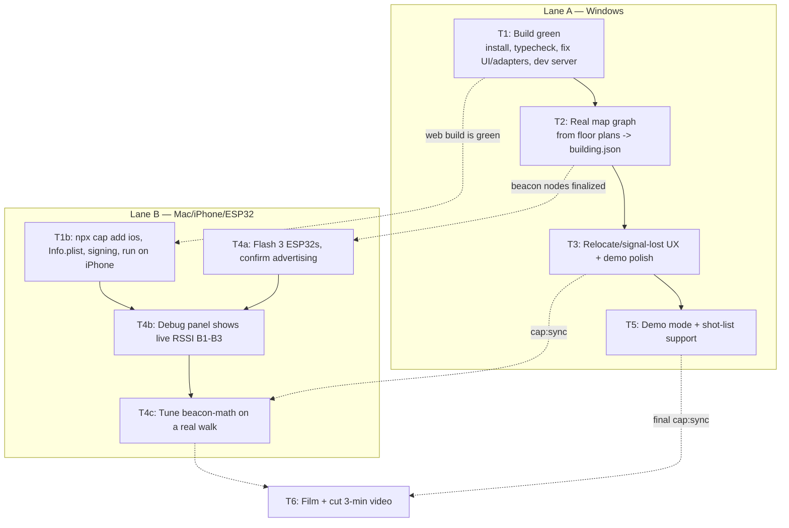

# Implementation Plan — Shortcut hackathon finish (6 hours)

## Problem Statement
Take Shortcut from "tested pure logic + unverified UI/adapters + demo map" to a working iOS app that demonstrates real end-to-end indoor navigation (BLE + step counting) well enough to capture a 3-minute judge video. Two parallel lanes: Lane A (Windows machine) handles all code, map data, and demo scaffolding; Lane B (teammate, Mac + iPhone + 3 ESP32s) handles Xcode build, device permissions, flashing beacons, and the on-device walk + filming. No live demo — the video is the deliverable, so a manual "I'm here" fallback must always work.

## Requirements
- Full iOS kit available on a teammate's Mac, not the primary dev machine -> serial-ish with a parallel device lane.
- BLE must genuinely work in the video (beacon snaps the dot at known points).
- End-to-end nav on a real iPhone: pick destination -> set location -> route + turn-by-turn -> dot moves.
- Deliverable is a 3-min video, no live demo -> prioritize a repeatable, safe shot list with fallback.
- Real building map built from floor plan images the user drops in; build the node/edge/beacon graph (coordinates eyeballed/derived from the images + at least one reference measurement for scale).
- Video content = mix of BLE positioning and classic turn-by-turn nav.
- Position comes from BLE beacons, step counting, and manual "I'm here" taps.

## Background (from reading the code)
- `src/lib/*` is pure and covered by 27 Node tests (`npm run test:logic`, now 72 with the demo-ux-polish and map-focus-view tests) — routing (Dijkstra), directions, `BeaconTracker` (EMA + hysteresis), PDR math, deep-link parsing. Solid foundation; keep it green.
- `PositionEngine` (`engine.ts`) is the single source of truth; all sources (`setAnchor`, `onBeacon`, `onStep`, `setPoint`) funnel through it. BLE remains nearest-beacon (not trilateration): one-second RSSI batches, EMA, hysteresis, and two consecutive decisions select a stable fix. Accelerometer-confirmed steps use compass+gyroscope fused headings for dead reckoning; a close current beacon periodically corrects drift.
- `App.tsx` already wires destination select, BLE toggle, steps toggle, accessible routing, a Debug panel (live RSSI, heading, step count, teleport, clear), arrival message, and `?at=/?to=` deep links. Toasts exist but there's no explicit "BLE signal lost -> relocate" prompt yet (step 6 of KIRO_PROMPT).
- `ble.ts`, `motion.ts`, `MapView.tsx` were authored without ever being run -> typecheck/build errors and Leaflet/Capacitor typing issues are likely. This is where Lane A's first hours go.
- `building.json` is the two-floor demo map; beacons B1/B2/B3 map to nodes. Firmware (PlatformIO, `firmware/esp32_beacon`) advertises `CNAV-<id>` on the service UUID in `config.ts`; ids and calibration are set at runtime over BLE/serial. Flashed and tested on all three boards.
- `capacitor.config.ts` has a placeholder `appId` (`com.shortcut.app`) that needs a unique bundle id for free-account signing. No `ios/` folder yet (`npx cap add ios` not run).
- Environment caveat: the primary machine is Windows; can run `npm install`, `typecheck`, `test:logic`, and `build` here, but not Xcode/`cap add ios`/BLE — those are Lane B. Floor plan images can be read but not auto-traced into coordinates; node placement is eyeballed from the images plus a reference measurement.

## Proposed Solution
Run two lanes that sync at defined checkpoints:

Lane A gets a green build fast so Lane B can `cap add ios` and run on the phone early (device bring-up is the long pole). Map and UX polish layer on while Lane B flashes and tunes beacons. Everything converges on filming, with a teleport/manual fallback guaranteeing usable footage.

## Task Breakdown
Lane A = Windows machine. Lane B = teammate on Mac. Times are budget guidance within the 6 hours, not hard gates.

- [ ] **Task 1 (Lane A, ~60 min): Get the build green.**
  Objective: `npm install`, `npm run typecheck`, `npm run test:logic`, `npm run build`, and `npm run dev` all succeed with no behavior changes beyond fixing breakage.
  Guidance: Fix type/build errors in the likely spots — `src/components/MapView.tsx` (Leaflet `@types/leaflet` usage, `CRS.Simple`, layer typing), `src/positioning/ble.ts` (`@capacitor-community/bluetooth-le` `ScanResult`/`BleClient` types), and `motion.ts` (`WakeLockSentinel`, iOS permission casts). Don't change positioning behavior; only make it compile and run. Keep `src/lib/*` pure.
  Test: `npm run test:logic` stays green (72 passing); `tsc --noEmit` clean; dev server renders the map and lets you set your location from "I'm at", pick a destination, and get a route in the browser.
  Demo: In the browser, pick a destination, tap-to-teleport (Debug), see the route and turn-by-turn update live.

- [ ] **Task 1b (Lane B, start once Task 1's `npm run build` is green): iOS app on the iPhone.**
  Objective: App installs and launches on the real iPhone.
  Guidance: Set a unique `appId` in `capacitor.config.ts`; `npm run build`, `npx cap add ios`, `npm run cap:sync`, `npm run cap:open`; add the two Info.plist keys (Bluetooth/Motion) from README section 2; pick Apple ID team + unique bundle id; enable Developer Mode on the phone; Run.
  Test: App launches on-device; destination list and map render; the Bluetooth permission prompt appears when turning Bluetooth on.
  Demo: The app running on the physical iPhone, picking a destination and viewing the map.

- [ ] **Task 2 (Lane A, ~75 min): Build the real building graph from the floor plans.**
  Objective: Replace `src/data/building.json` with the real building — floors, nodes (doors, junctions, stairs/elevator landings, named rooms), edges, beacon->node mappings, correct `metersPerUnit` and `northOffsetDeg` — with the data-consistency test passing.
  Guidance: User drops floor plan images into `public/plans/` (e.g. `f1.png`) and gives at least one real-world reference distance (e.g. "this corridor is 18 m") plus roughly where the 3 beacons will mount. Read the images, set each floor's `width`/`height` in plan units and `image: "/plans/f1.png"`, place nodes by eyeballing pixel positions (x right, y down), connect edges along corridors, add cross-floor stairs/elevator edges, compute `metersPerUnit` from the reference, and set `northOffsetDeg` from the plan's orientation. This is interactive — expect a back-and-forth where the user confirms/corrects node placements against the image.
  Test: `npm run test:logic` still passes (it validates every edge and beacon references a real node); spot-check in the dev server that nodes land on corridors and routes look sane.
  Demo: Dev server shows the real floor plan with the corridor graph overlaid; picking a real room produces a believable route and turn-by-turn.

- [ ] **Task 3 (Lane A, ~60 min): Relocate / signal-lost UX + demo polish.**
  Objective: Implement KIRO_PROMPT step 6 — a clear "you are here" state (verify), a prominent arrival message (polish), search/destination UX pass, and a new "BLE signal lost -> relocate" prompt when beacons go quiet. Keep manual "I'm here" always available as fallback.
  Guidance: Add a lightweight "signal lost" state driven by `onBeacon(null)` persisting for N seconds while BLE is on (surface a banner telling the user to choose where they are from "I'm at"). Keep all logic in `App.tsx`/components; position logic stays in `PositionEngine`. No new dependencies without flagging. Make small commits.
  Test: In the browser, toggle through states — no position, no destination, routing, arrived, no-route, and simulate signal-lost (BLE path is native-only, so stub/verify the state transition logic where feasible). `test:logic` stays green.
  Demo: Walking through the app shows a clean "you are here," a satisfying arrival message, and a relocate prompt when BLE drops — with manual "I'm here" always recovering position.

- [ ] **Task 4 (Lane B, ~90 min, overlaps Tasks 2–3): Beacons live + tuned on a real walk.**
  Objective: All 3 ESP32s advertising, Debug panel shows live RSSI for B1–B3 on the phone, and the nearest-beacon fix is stable while walking.
  Guidance: (4a) Flash every board with the same PlatformIO firmware (`pio run -e esp32s3|esp32|esp32-wrover-e -t upload`), set its id (B1/B2/B3) + calibration from the app or serial (`{"id":"B1"}`), confirm "Advertising as CNAV-Bx" on Serial, power from banks, mount per README section 3 (>=8–10 m apart, ~2 m high, same orientation/TX power). (4b) After a `cap:sync` with the Task 1 build, open Debug on the phone and confirm live RSSI per beacon. (4c) Walk the route; if the fix flips between beacons, raise `hysteresisDb` / lower `alpha` (and adjust `minRssi`) in `src/lib/beacon-math.ts`. Add a test when changing `beacon-math.ts` (lib is tested).
  Test: `test:logic` still green after any `beacon-math.ts` change; on a repeated walk the nearest-beacon anchor lands at the intended node without rapid flipping.
  Demo: On the phone, Debug shows B1/B2/B3 RSSI updating live; walking past a beacon snaps the dot to that beacon's node.

- [ ] **Task 5 (Lane A, ~30 min): Demo mode + shot-list support.**
  Objective: Make the planned video reliably reproducible, and ensure a one-tap safe fallback exists so filming never stalls.
  Guidance: Confirm the teleport/"I'm here"/Clear-position controls give a clean reset between takes. Verify the `?at=&to=` deep link can pre-stage a scene (open the app already positioned and routing) for the "classic nav" segment. If anything about the shot list is unclear, lock it here: Scene 1 (classic) pick "I'm at" (or deep link) -> route + turn-by-turn -> walk -> arrive; Scene 2 (BLE) Debug panel live RSSI -> walk between beacons -> dot snaps -> nav view. No behavior changes to `PositionEngine`.
  Test: Each scene can be set up from a clean state in under ~15 seconds; fallback (choosing a place from "I'm at") recovers instantly if BLE misbehaves on camera.
  Demo: A dry run of both scenes end-to-end using teleport in the browser, then the same on the phone.

- [ ] **Task 6 (Both, ~45 min): Final sync, film, and cut the 3-minute video.**
  Objective: Final `npm run cap:sync` with all Lane A work, then capture and edit the two scenes into a <=3-minute judge video.
  Guidance: Lane B does a final `cap:sync`/Run so the phone has the polished build + real map + tuned beacons. Record screen (iOS screen recording) for UI clarity plus an over-the-shoulder walking shot. Keep the manual fallback ready. Cut to <=3 min: problem framing, classic nav scene, BLE scene, quick architecture mention (ESP32 beacons + steps + manual anchors through one `PositionEngine`).
  Test: Playback confirms both positioning stories read clearly on screen within the time limit.
  Demo: The finished 3-minute video — the actual judge deliverable.

## Sync points & risks
Dependencies/sync points: Task 1 green unblocks Task 1b. Task 2's finalized beacon nodes unblock precise Task 4a mounting. Tasks 3 and 5 should be `cap:sync`'d before Task 4c's final tuning walk and before Task 6 filming. If BLE tuning (4c) runs long, Task 5's fallback guarantees a complete nav story can still be filmed.

Risk notes: biggest unknowns are (1) how many type errors lurk in the never-run adapters — Task 1 is time-boxed but could overrun; (2) on-device BLE behavior with only 3 beacons in a real building — mitigated by hysteresis tuning and the manual fallback; (3) map coordinate accuracy from eyeballing plans — mitigated by the interactive confirm loop in Task 2.
3